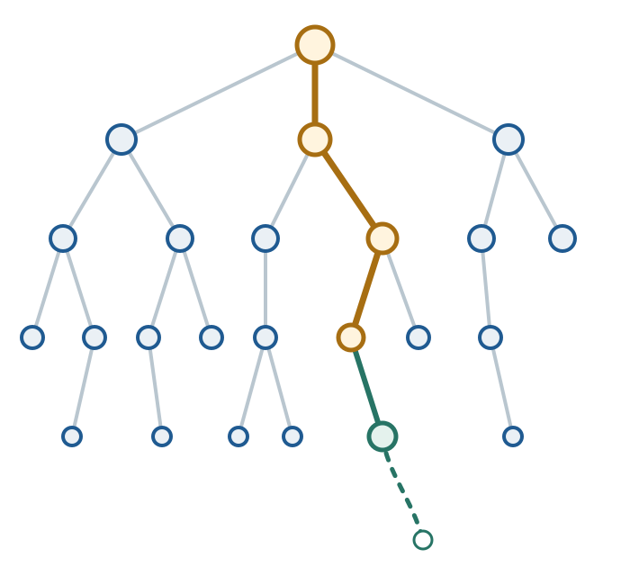
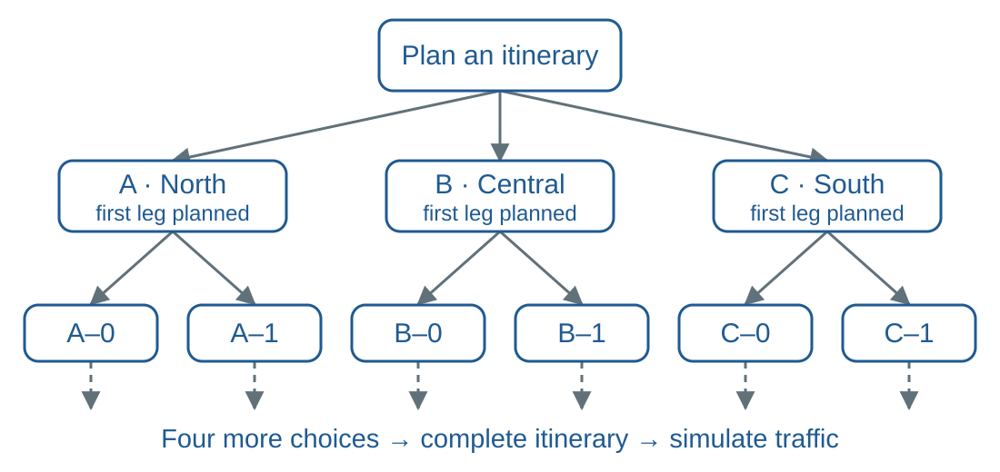
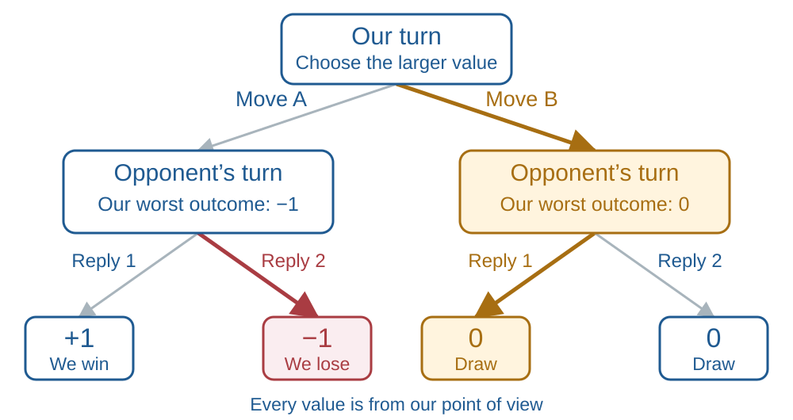
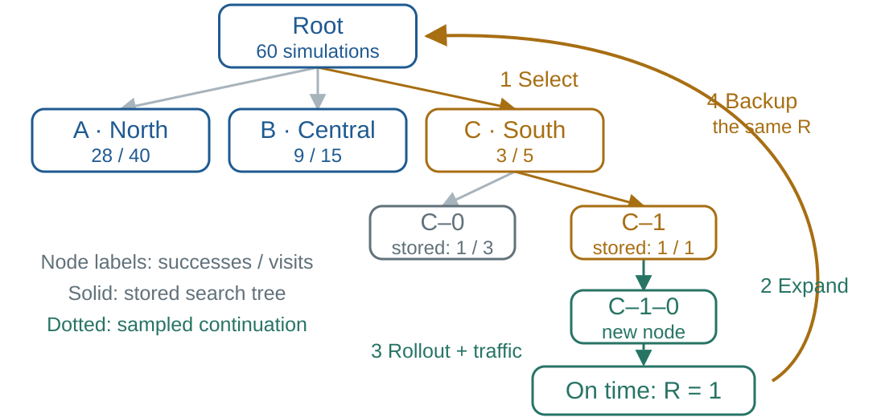

# Course Map {.deck-course-map tree-marker="deck-05-overview"}

::: {.columns}
::: {.column width="36%"}
<h3>Course decks</h3>

- []()
- []()
- []()
- []()
- [](){.current-deck aria-current="page"}
:::

::: {.column width="4%"}
:::

::: {.column width="60%"}
::: {.deck-map-theme}
[Choose how to compute, optimize, search, and allocate]{.alert}
:::

:::
:::

::: {.deck-section-links}
<h3>This deck</h3>

- [Parallel Computing](#parallel-computing-section)
- [Multilevel Monte Carlo](#multilevel-monte-carlo)
- [Stochastic Gradient Descent](#stochastic-gradient-descent-section)
- [Monte Carlo Tree Search](#monte-carlo-tree-search)
- [Big Ideas](#big-ideas)
:::

# Parallel Computing {#parallel-computing-section .tree-marker-slide tree-marker="practice"}

<span id="parallel-and-stochastic-computation"></span>

::: {.section-main-idea}
Evaluate different sample points on several processors to [reduce elapsed time]{.alert}
:::

- [Parallel computing](#parallel-computing)
- [CPU and GPU Monte Carlo](#cpu-and-gpu-monte-carlo)

## Parallel computing {.tree-marker-slide tree-marker="practice"}

Modern CPUs and GPUs can evaluate many operations concurrently

- Monte Carlo function values are often [pleasingly parallel]{.alert}: samples can be evaluated independently
- Parallel random-number streams must remain nonoverlapping and statistically sound
- GPU arithmetic is often optimized for 32-bit floating point rather than 64-bit floating point
- Reduced precision may lose significant digits but can increase throughput substantially
- GPUs help most when there are [many similar operations]{.alert}<br>Launch and
  data-transfer costs can dominate small problems

::: {.key-point}
Parallelism changes computational cost

It does not repair biased estimators or poor sampling designs
:::

## CPU and GPU Monte Carlo {#cpu-and-gpu-monte-carlo .tree-marker-slide tree-marker="practice"}

The prepared laptop demonstration compares

- NumPy CPU float64 and float32
- PyTorch CPU float32 and available GPU float32
- One expectation and many expectations evaluated in batches

Check the [actual backend]{.alert}, include generation and evaluation, and synchronize GPU timing

::: {.key-point}
A faster processor helps when the [workload outweighs its overhead]{.alert}
:::

::: {.notes}
Instructor companion: notebooks/performance/GPU_MonteCarlo_Demo.ipynb.
Mini, M5, and classroom M3 executions are saved/verified in the course handoff;
the current notebook outputs describe M3 Max. Content review remains with Fred.
Add the student-facing notebook link after review. The optional dependency is
documented in requirements-gpu.txt.
:::

---

### Reading the CPU/GPU experiment {#reading-cpu-gpu-experiment}

- Read speedup as [CPU time / GPU time]{.alert}: above one favors the GPU
- Name the baseline: NumPy CPU64, NumPy CPU32, or Torch CPU32<br>
  The ratio compares complete implementations, including their random generators
- Small jobs can favor CPUs; larger jobs spread fixed GPU overhead over more work
- Generation can dominate: inspect stage timings before attributing a gap to evaluation

::: {.key-point}
[End-to-end time]{.alert} determines the practical gain
:::

::: {.notes}
In the saved M3 Max run, at 262144 points the Torch CPU32 generation diagnostic
is 25.196 ms versus 0.719 ms for evaluation; MPS is 0.507 ms versus 0.928 ms.
Evaluation alone does not explain the complete-run GPU advantage. These stage
medians exclude input conversion/transfer and are not an additive breakdown
of the complete runs. Timings are illustrative, machine-specific measurements.
CPU and GPU core counts do not predict their speedup ratio.
:::

---

### Faster computation and statistical accuracy {#parallel-speed-and-accuracy}

Compare a [baseline]{.alert} and a [faster implementation]{.alert}: single-core / multicore CPU, or CPU / GPU<br>
For fixed sampling method; runtime proportional to sample count

\begin{equation*}
\left.
\begin{aligned}
s=\frac{\operatorname{time}_{\mathrm{baseline}}(n)}{\operatorname{time}_{\mathrm{faster}}(n)}>1
&\quad\implies\quad n_{\mathrm{faster}}\approx s\,n_{\mathrm{baseline}}\\
\operatorname{error}(n)\approx A n^{-p}
&\quad\implies\quad
\frac{\operatorname{error}(n_{\mathrm{faster}})}{\operatorname{error}(n_{\mathrm{baseline}})}\approx\frac1{s^p}
\end{aligned}
\right\}
\quad\begin{gathered}\alerttext{for the same}\\\alerttext{time budget}\end{gathered}
\end{equation*}

Error: RMSE for IID/RQMC; absolute-error bound for QMC

| Method | Power $p$ | Conditions |
|:---|:---|:---|
| IID | $1/2$ | Finite contribution variance |
| QMC | $\approx1$ | Sufficient smoothness and a suitable design |
| RQMC | $\approx3/2$ | Sufficient smoothness and suitable scrambling |

Speedup $s=16$: about $1/4$ of the IID RMSE, $1/16$ of the QMC bound, $1/64$ of the RQMC RMSE

::: {.notes}
Assume negligible floating-point error and comparable variance, and ignore
setup/overhead in the same-time calculation. Float32 can eventually impose a
numerical error floor; the saved experiment does not locate that floor.
time_baseline(n)/time_faster(n) compares the time for the same n contributions.
In the throughput regime, time is approximately proportional to sample count,
so speedup s permits s times as many points at the same time budget.
For a model error(n) approximately A n^{-p}, the ratio is s^{-p}.
Keep the sampling method, integrand, and error constant A comparable between
implementations. IID uses RMSE sigma/sqrt(n); deterministic QMC uses an
absolute-error bound, not RMSE over randomizations or a ratio of actual errors.
The displayed QMC/RQMC powers suppress logarithmic factors and are illustrative,
not universal guarantees. QMC requires the smoothness/variation assumptions
of its bound and a suitable point design. Smooth-integrand RQMC rates near
n^{-3/2} require an appropriate randomization, such as nested uniform
scrambling of suitable digital nets; a generic random shift does not ensure
that rate. For replicated RQMC, keep the number of replications fixed.
The s=16 examples use the nominal powers 1/2, 1, and 3/2.
This applies to single-core versus multicore CPU implementations as well as
CPU versus GPU implementations; name the actual baseline in either case.
Total sample count controls sampling error; batch size controls memory and
throughput. At fixed batch size, speedup can level off as both runtimes become
proportional to n. Eight replications give a noisy empirical RMSE; a lucky
point does not rank precision.
In the M3 fixed-n sweep, changing batches from 4096 to 262144 reduces GPU
runtime from 34.22 to 3.92 ms without changing n=1048576 or its IID error law.
Larger batches need not always help; choose using measurements and memory limits.
:::

---

### Computing many expectations together {#parallel-many-expectations}

- Reuse one sample batch across many functions to share generation cost and expose matrix work
- More expectations add [outputs]{.alert}; each expectation still uses the same $n$ samples
- Shared inputs give [correlated estimates]{.alert}; their spread is not a standard error
- Batch samples and functions to bound memory; measure the useful workload and backend

::: {.key-point}
More outputs can improve throughput without improving accuracy per output
:::

::: {.notes}
In the saved M3 Max run, 512 expectations take 56.8 ms on MPS: 16.4 times
faster than NumPy CPU64, 6.3 times faster than NumPy CPU32, but only 2.0 times
faster than Torch CPU32. The named baseline materially changes the conclusion.
Small many-expectation timings are nonmonotone; do not infer a universal
crossover or cause from three repetitions. Centers are added in order, changing
the functions in the collection; mean absolute error across them is not a
convergence curve. Independent whole-run replications are needed to assess
sampling uncertainty. Keep the existing M3 measurements when editing prose.
:::

# Multilevel Monte Carlo {.tree-marker-slide tree-marker="estimation"}

::: {.section-main-idea}
Combine many cheap coarse samples with fewer correction samples to [reduce the cost]{.alert} of accurately estimating an expectation with high dimensional random input
:::

[Common MLMC glossary](#mlmc-glossary)

- [Two-level Monte Carlo](#two-level-monte-carlo)
- [Allocating work optimally](#allocating-work-optimally)
- [A hierarchy of coupled approximations](#infinite-dimensional-expectations)
- [Optimal multilevel allocation](#optimal-multilevel-allocation)
- [Why telescoping helps](#why-telescoping-helps)
- [Cost versus accuracy: IID](#multilevel-random-cost-exponent)

---

### MLMC glossary: contributions {#mlmc-glossary}

<span id="mlmc-error-work-glossary"></span>
<span id="two-level-notation"></span>

The same notation works for $L=2$ or many levels

::: {.mlmc-glossary}
| Symbol | Meaning |
|:---|:---|
| $\ell$, $L$ | Level index and finest included level |
| $d_\ell$, $f_{d_\ell}$ | Resolution and approximate output function |
| $Y_\ell$ | Cheap output at level 1; fine output minus coarse output at later levels |
| $\mu_\ell$, $\hmu_\ell$ | Contribution mean $\Ex(Y_\ell)$ and its estimate |
| $\mu_{d_L}$ | Mean of the finest approximation: $\sum_\ell\mu_\ell$ |
| $V_\ell$ | IID contribution variance $\var(Y_\ell)$ |
:::

---

### MLMC glossary: samples and work {#mlmc-work-glossary}

::: {.mlmc-glossary}
| Symbol | Meaning |
|:---|:---|
| $n_\ell$, $n=\sum_\ell n_\ell$ | Level sample count and total sample count |
| $\$_\ell$ | Work for one complete contribution at level $\ell$ |
| $w_\ell$ | Sample allocation weight: $n_\ell/n=w_\ell/\sum_k w_k$ |
:::

Total work, for two or many levels

$$
C=n_1\$_1+n_2\$_2+\cdots+n_L\$_L
=\sum_{\ell=1}^L n_\ell\$_\ell
$$

$C(\varepsilon)$ is the work needed at error tolerance $\varepsilon$

::: {.key-point}
[Sample counts]{.alert} and [work shares]{.alert} differ
:::

::: {.notes}
Introduce the method-specific amplitude A_l and decay power p only when
needed in the two-level error models. For IID, A_l^2=V_l. Random methods
use RMSE; deterministic QMC uses a justified absolute-error bound.

The fixed work budget C determines n; n and C are not independently imposed
budgets. Work shares are proportional to cost_l w_l, whereas sample shares
are proportional to w_l. Complete contribution work includes inputs,
transforms, and coarse/fine evaluations with any legitimate reuse.
Setup, pilots, and allowed sample-size rounding must also be charged.

For RQMC, n_l=R N_l counts all evaluations over a fixed number R of
independent randomizations with N_l points in each run. Estimate variance
of the complete reported mean across independent randomizations, rather than
using individual output variance as an RQMC error estimate. These additional
symbols belong in the notebook and detailed notes, not the opening catalog.
:::

## Two-level Monte Carlo {#two-level-monte-carlo .tree-marker-slide tree-marker="estimation"}

<span id="splitting-an-expectation"></span>

We want to compute $\Ex\bigl[f_{d}(\vX_{1:d})\bigr]$ for large $d$

But large $d$ costs more, e.g., $\$\bigl(f_d(\vX_{1:d})\bigr)\propto d$

- [Computational finance]{.alert}: $d=$ time steps $\times$ number of assets
- [ODE/PDE models with random fields]{.alert}: $d=$ grid points representing the field

Choose $d_1\ll d_2=d$; couple the outputs to [reduce the variance of their difference]{.alert}

\begin{align*}
Y_1&=f_{d_1}(\vX_{1:d_1})& &\alerttext{cheap}\text{ approximation}\\
Y_2&=f_{d_2}(\vX_{1:d_2})-f_{d_1}(\vX_{1:d_1})& &\alerttext{expensive}\text{ correction}
\end{align*}

$$
\mu=\Ex\{f_{d}(\vX_{1:d})\}=\Ex(Y_1)+\Ex(Y_2)
$$

::: {.key-point}
Estimate the [cheap part often]{.alert} and the [expensive correction less often]{.alert}, if its error is easier to control
:::

::: {.notes}
Here mu is the full two-level mean at the fixed fine resolution d=d2,
equal to mu1+mu2. The hierarchy section separately distinguishes a finite
fine mean from a limiting target when introducing approximation bias.
The displayed linear cost is an illustrative model for evaluation,
not a universal dimension law. Cost includes input generation, transforms,
and evaluation; dense factorizations or other solvers can cost more than O(d).
In finance, d can count the scalar random inputs for a time-by-asset path
discretization. In a random-field ODE/PDE model, d can count field values
on a grid; the field-generation and solver costs need not be linear in d.
A complete coupled correction costs roughly the fine evaluation plus any
coarse work that cannot be reused. Its cost is typically of order d2 in
this illustrative setting, whereas the cheap level costs order d1.
Within Y2, coarse and fine approximations share a path or compatible inputs.
The two outputs being subtracted are coupled; the goal is small variance
of their difference, not small variance of either output separately. If
F and G denote the fine and coarse outputs within one correction, then
Var(F-G)=Var(F)+Var(G)-2 Cov(F,G). A strong positive covariance can therefore
reduce correction variance, even when both output variances are substantial.
Coupling is a joint construction preserving the required marginal law of
each output. Shared randomness alone does not guarantee a good coupling.
The expectation identity remains valid because those marginal means are
unchanged. The expectation here is scalar; high dimensionality describes
the random input vector used to generate the output.
For time discretizations, preserve Brownian values at shared times;
a Brownian bridge can refine the coarse path. Between the two level estimators, use
independent samples or independent RQMC randomizations.
A small mean correction does not imply a small variance or a small QMC
error constant. Coupling should make the correction easier to integrate;
that property, together with the cost ratio, must justify two levels.
:::

---

### Coupling coarse and fine Brownian paths {#coupled-brownian-paths}

Choose nested monitoring grids on $[0,T]$ with $d_2=\kappa d_1$, $\kappa>1$

- Order the Brownian values $\vX$ with the [coarse-grid values first]{.alert}
- Use a [Brownian bridge]{.alert} to add values at the extra fine-grid times

For an option, $f_{d_\ell}(\vX_{1:d_\ell})$ computes its [discounted payoff]{.alert}<br>
using the path values at $d_\ell$ monitoring times

\begin{align*}
Y_1&=f_{d_1}(\vX_{1:d_1})&&\alerttext{cheap}\text{ coarse payoff}\\
Y_2&=f_{d_2}(\vX_{1:d_2})-f_{d_1}(\vX_{1:d_1})&&\alerttext{expensive}\text{ payoff correction}
\end{align*}

- Estimate $\Ex(Y_1)$ from coarse-only paths
- Estimate $\Ex(Y_2)$ from a [separate independent]{.alert} set of bridge-refined paths

::: {.key-point}
Same path, two payoffs in $Y_2$; aim for [small variance of their difference]{.alert}
:::

::: {.notes}
Here X_1:d1 contains coarse-grid Brownian values. Append the conditionally
generated Brownian-bridge values at added times to obtain X_1:d2. This is
hierarchical rather than chronological ordering. Each payoff function knows
the monitoring times attached to its inputs and restores chronological order
when needed. Thus the coarse vector is literally a prefix of the fine vector,
matching the f_d notation on the preceding slide.
Nested grids may be nonuniform. Counts d1 and d2 are positive integers and
kappa=d2/d1>1. Equally spaced nested grids require an integer refinement factor;
general nested grids allow other ratios. No bridge-generation details are
needed here. The notebook's dyadic grids illustrate one particular choice.
The fine and coarse approximations use the same Brownian values at shared
times; their payoffs need not agree. Generate correction paths independently
of the coarse-only sample set used for the cheap mean. For RQMC, use
independent randomizations between level estimates; points within a run may
be dependent. The coarse-only sample has the same marginal law as the coarse
part of a refined path, preserving the telescoping expectation identity.
Coupling's benefit still depends on the correction's method-specific error.
:::

---

### Random two-level estimates: IID or RQMC {#random-two-level-estimates}

Estimate $\mu_\ell=\Ex(Y_\ell)$ with [uncorrelated level sample means]{.alert}: $\operatorname{cov}(\hmu_1,\hmu_2)=0$<br>
Independent sample sets $\{Y_{i,1}\}_{i=0}^{n_1-1}$ and $\{Y_{i,2}\}_{i=0}^{n_2-1}$ ensure this condition

\begin{align*}
\hmu&=\hmu_1+\hmu_2&
\hmu_\ell&=\frac1{n_\ell}\sum_{i=0}^{n_\ell-1}Y_{i,\ell}\\
\var(\hmu)&=\var(\hmu_1)+\var(\hmu_2)&
C&=n_1\$_1+n_2\$_2
\end{align*}

For unbiased level estimates, model $\operatorname{RMSE}(\hmu_\ell)\approx A_\ell n_\ell^{-p}$

$$
\operatorname{MSE}(\hmu)
=\var(\hmu)
\approx\frac{A_1^2}{n_1^{2p}}+\frac{A_2^2}{n_2^{2p}}
$$

- [IID]{.alert}: $p=1/2$, $A_\ell^2=\var(Y_\ell)$; the variance model is exact
- [RQMC]{.alert}: $p$ and $A_\ell$ depend on smoothness, design, and randomization<br>
  Points within each sample set may be dependent

::: {.notes}
The MSE here is relative to the full two-level mean mu at the fixed fine resolution.
Use a positive common exponent p for this allocation model and positive
amplitudes A_l. Different levels can have different rates; the common-p
formulas are a simplifying model, not a claim that all rates agree.
For RQMC, Y_il are values from a randomized design with the correct marginals.
Unbiasedness is assumed, and the variance is over design randomizations.
Variance addition requires Cov(hmu1,hmu2)=0; independence is sufficient,
not necessary. The explicitly indexed sample sets can be generated
independently between levels, with independent RQMC
randomizations. Within-level points may be dependent. The algebraically
defined Y1 and Y2 need not be uncorrelated when evaluated on the same path;
the zero-covariance condition is on their separately sampled level means.
Within the correction Y2, retain the coarse/fine coupling.
With a fixed number R of independent runs per
level, n_l can denote total evaluations; absorb fixed replication factors
into A_l and keep cost per evaluation consistent. More explicitly, n_l=R N_l
and Var(mean of R runs) approximately a_l^2 N_l^{-2p}/R, so the amplitude
in total-count notation is A_l=a_l R^{p-1/2}. Keep R fixed when varying n_l.
Smooth integrands under suitable scrambling may have p near 3/2, ignoring
logarithmic factors; a generic random shift does not guarantee that rate.
:::

## Allocating work optimally {.tree-marker-slide tree-marker="estimation"}

For [independent unbiased random estimates]{.alert}, minimize the MSE model

$$
\frac{A_1^2}{n_1^{2p}}+\frac{A_2^2}{n_2^{2p}}
\quad\text{subject to}\quad n_1\$_1+n_2\$_2=C
$$

The optimal continuous allocation satisfies

$$
\frac{n_1}{n_2}
=\left(\frac{A_1^2\$_2}{A_2^2\$_1}\right)^{1/(2p+1)}
$$

IID ($p=1/2$, $A_\ell^2=V_\ell$): [sample allocation weights]{.alert}

$$
w_\ell=\frac{A_\ell}{\sqrt{\$_\ell}}=\sqrt{\frac{V_\ell}{\$_\ell}}
\qquad\frac{n_1}{n_2}=\frac{w_1}{w_2}
\qquad\frac{n_\ell}{n}=\frac{w_\ell}{w_1+w_2}
$$

More points for [larger error amplitude]{.alert}; fewer for [larger cost per point]{.alert}

::: {.notes}
For positive amplitudes and costs, differentiate the Lagrangian:
$2p A_\ell^2 n_\ell^{-(2p+1)}=\lambda\$_\ell$. The common factor $2p$ cancels
in the ratio. This is exact optimization of the continuous power-law model;
RQMC power laws are generally approximations. At p=1/2 the optimal IID MSE
is $(\sqrt{V_1\$_1}+\sqrt{V_2\$_2})^2/C$, as in the original IID treatment.
Round to positive admissible sample sizes; RQMC may require powers of a base.
Include setup and pilot costs in practical work. Pilot estimates of IID
variance do not automatically identify RQMC amplitudes or rates; use whole
randomized estimates and justify the applicable model.
:::

---

### Deriving the two-level allocation {#two-level-optimization}

For the [random]{.alert} case, treat $n_1,n_2>0$ as continuous; fix total work $C$

$$
\underbrace{\mathcal L}_{\text{Lagrangian}}
=\frac{A_1^2}{n_1^{2p}}+\frac{A_2^2}{n_2^{2p}}
+\lambda(n_1\$_1+n_2\$_2-C)
$$

\begin{align*}
\frac{\partial\mathcal L}{\partial n_\ell}=0
&\implies\frac{2pA_\ell^2}{n_\ell^{2p+1}}=\lambda\$_\ell
\qquad(\ell=1,2)\\
\frac{A_1^2}{\$_1n_1^{2p+1}}
&=\frac{A_2^2}{\$_2n_2^{2p+1}}
\implies\frac{n_1}{n_2}
=\left(\frac{A_1^2\$_2}{A_2^2\$_1}\right)^{1/(2p+1)}
\end{align*}

The [sample allocation weights]{.alert} give

$$
w_\ell=\left(\frac{A_\ell^2}{\$_\ell}\right)^{1/(2p+1)}
\qquad
n_\ell=\frac{Cw_\ell}{\$_1w_1+\$_2w_2}
=\frac{nw_\ell}{w_1+w_2}
$$

::: {.key-point}
At the optimum, each level buys the same [marginal MSE reduction per unit work]{.alert}
:::

::: {.notes}
This derives the random allocation on the preceding slide. Keep the IID
marginal-MSE continuations with this derivation before the deterministic bounds.
Differentiate the MSE model, not RMSE, since their minimizers agree.
The magnitude of the derivative with respect to work on level ell is
2p A_ell^2/(cost_ell n_ell^(2p+1)). If these marginal gains differ,
transfer a little work toward the level with the larger gain.
For p>0 and positive amplitudes and costs, the objective is strictly convex
and diverges at either boundary of the feasible budget segment; the stationary
point is the unique global continuous minimum. RQMC still uses an approximate
variance model. Round up to allowed counts when targeting a tolerance;
the fixed-budget continuous solution may need adjustment for admissible sizes.
:::

---

### IID: MSE decrease per unit work {#two-level-marginal-mse}

Treat $n_\ell>0$ as continuous; keep $A_\ell,\$_\ell$ fixed

\begin{align*}
\operatorname{MSE}_\ell&=\frac{A_\ell^2}{n_\ell}
&\implies\quad
\frac{\mathrm d\operatorname{MSE}_\ell}{\mathrm dn_\ell}
&=-\frac{A_\ell^2}{n_\ell^2}\\
\operatorname{cost}_\ell&=n_\ell\$_\ell
&\implies\quad
\frac{\mathrm d\operatorname{cost}_\ell}{\mathrm dn_\ell}&=\$_\ell
\end{align*}

The [MSE decrease per unit work]{.alert} is the ratio of these derivatives

$$
-\frac{\mathrm d\operatorname{MSE}_\ell}{\mathrm d\operatorname{cost}_\ell}
=-\frac{\mathrm d\operatorname{MSE}_\ell/\mathrm dn_\ell}
{\mathrm d\operatorname{cost}_\ell/\mathrm dn_\ell}
=\frac{A_\ell^2}{\$_\ell n_\ell^2}
$$

::: {.notes}
The derivative is evaluated in the continuous allocation model, with A_ell
and cost per contribution fixed and positive. The minus sign makes the
MSE decrease positive. The chain rule converts a change per extra sample
into a change per unit of work. If the two derivative magnitudes differ,
transfer a small amount of work toward the level with the larger magnitude;
the total MSE decreases to first order. The Lagrange equations on the
preceding slide set these magnitudes equal to lambda. For IID, w_ell is
A_ell/sqrt(cost per contribution), so equal magnitudes imply equal w_ell/n_ell.
Setup, pilots, and sample-size rounding remain outside this linear model.
The next continuation connects the derivative to level RMSE and sample weights.
:::

---

### IID: interpreting the optimal allocation {#two-level-marginal-allocation}

Write $\operatorname{err}_\ell^2=\operatorname{MSE}_\ell$ and $w_\ell=A_\ell/\sqrt{\$_\ell}$

$$
-\frac{\mathrm d\operatorname{MSE}_\ell}{\mathrm d\operatorname{cost}_\ell}
=\frac{A_\ell^2}{\$_\ell n_\ell^2}
=\frac{\operatorname{err}_\ell^2}{\operatorname{cost}_\ell}
=\left(\frac{w_\ell}{n_\ell}\right)^2
$$

If one level has a larger value, moving a little work to it lowers total MSE

At the optimum, both derivative magnitudes equal $\lambda$

$$
\left(\frac{w_1}{n_1}\right)^2
=\left(\frac{w_2}{n_2}\right)^2=\lambda
\implies\frac{n_1}{n_2}=\frac{w_1}{w_2}
$$

::: {.key-point}
Optimal allocation equalizes the [MSE decrease per unit work]{.alert}
:::

::: {.notes}
The term err_ell is the RMSE of the level sample mean, not an observed error.
This interpretation uses the continuous IID model on the preceding slide.
Positive weights and sample counts let us take square roots of the equality.
:::

---

### Deterministic two-level estimates {#deterministic-two-level-estimates}

Use QMC separately for the same cheap part and coupled correction

Assume justified [absolute-error bounds]{.alert} with a common $p>0$

\begin{align*}
\abs{\hmu_\ell-\mu_\ell}&\le\frac{A_\ell}{n_\ell^p}\\
\abs{\hmu-\mu}
&\le\abs{\hmu_1-\mu_1}+\abs{\hmu_2-\mu_2}
\le\frac{A_1}{n_1^p}+\frac{A_2}{n_2^p}
\end{align*}

At fixed work $n_1\$_1+n_2\$_2=C$, minimize the [bound]{.alert}

$$
w_\ell=\left(\frac{A_\ell}{\$_\ell}\right)^{1/(p+1)}
\qquad\frac{n_1}{n_2}=\frac{w_1}{w_2}
=\left(\frac{A_1\$_2}{A_2\$_1}\right)^{1/(p+1)}
$$

QMC needs sufficient [smoothness]{.alert} and a suitable design<br>Bound total error by the [sum of the level error bounds]{.alert}

::: {.notes}
This is a triangle-inequality upper bound, not a sum-of-variances identity
or an equality for the realized integration error. No independence or
unbiasedness is asserted for deterministic estimates. Minimize the stated
upper bound, not the unknown actual error. Differentiation gives
$p A_\ell n_\ell^{-(p+1)}=\lambda\$_\ell$ and the displayed ratio.
A_l here is a deterministic error-bound amplitude, not the RQMC amplitude
or the contribution SD. For a suitable RKHS bound it may be a discrepancy
rate constant times the variation of the complete level integrand.
An illustrative rate is p near 1 with appropriate smoothness and design;
retain logarithmic factors if needed. A small correction variance alone
does not guarantee a small deterministic QMC error amplitude.
This bound is relative to the full two-level mean mu at the fixed fine resolution. Limiting-target
approximation bias is treated separately in the hierarchy section.
:::

---

### What two levels accomplish

- $d_1\ll d_2$: the coarse approximation can be much [cheaper]{.alert}
- Coupling can make the expensive correction [easier to integrate]{.alert}
- Allocate points using the error amplitudes, rates, and complete evaluation costs
- [IID/RQMC]{.alert}: independent unbiased level estimates add variances
- [Deterministic QMC]{.alert}: level error bounds add by an inequality
- Fix the target dimension $d_2$; increase $n_1,n_2$ to control integration error

::: {.key-point}
Two levels help when the [cheap approximation]{.alert} and [small correction error]{.alert} earn their combined cost
:::

::: {.notes}
The correction must be small in the sense relevant to the integration method:
variance for IID, randomized-estimate error amplitude for RQMC, and a justified
variation/discrepancy bound for deterministic QMC. Neither a small correction
mean nor pointwise closeness alone establishes all these properties.
:::

---

### Two-level random cost as a function of error {#two-level-cost-for-accuracy}

Fix grids, amplitudes, and costs; use the [IID or RQMC model](#random-two-level-estimates) with common $p>0$

Scale the optimal counts together: $n_1=t w_1$, $n_2=t w_2$, $t>0$

From the [optimal-weight definition](#two-level-optimization): $A_1^2=\$_1w_1^{2p+1}$ and $A_2^2=\$_2w_2^{2p+1}$

\begin{align*}
S&=\$_1w_1+\$_2w_2
\qquad C=n_1\$_1+n_2\$_2=tS\\
\operatorname{MSE}(\hmu)
&\approx\frac{A_1^2}{(tw_1)^{2p}}+\frac{A_2^2}{(tw_2)^{2p}}\\
&=\frac{\$_1w_1^{2p+1}}{t^{2p}w_1^{2p}}
+\frac{\$_2w_2^{2p+1}}{t^{2p}w_2^{2p}}
=\frac{\$_1w_1+\$_2w_2}{t^{2p}}=\frac{S}{t^{2p}}
\end{align*}

$$
\operatorname{RMSE}(\hmu)\approx\frac{\sqrt S}{t^p}\approx\varepsilon
\implies t\approx\left(\frac{\sqrt S}{\varepsilon}\right)^{1/p}
$$

::: {.key-point}
$$
C(\varepsilon)=tS
\approx S\left(\frac{\sqrt S}{\varepsilon}\right)^{1/p}
=S^{1+1/(2p)}\varepsilon^{-1/p}
$$
:::

::: {.notes}
Use unbiased, uncorrelated level estimates and the same positive sampling-error
power p on both levels. The optimal weights fix the ratio of the two sample
counts; the single scale t controls their size and the total work.
The weight definitions give A1^2=cost1*w1^(2p+1) and
A2^2=cost2*w2^(2p+1), making the cancellation explicit for both levels.
The visible link returns to the weight definition: raise each weight to
the power 2p+1, then multiply by its per-contribution cost.
Set the modeled RMSE equal to the requested tolerance to find the required
scale, then multiply by S to obtain total work. The general random model is
approximate. For IID, p=1/2, A1^2=V1, and A2^2=V2, so it gives exactly
C(epsilon)=(sqrt(V1*cost1)+sqrt(V2*cost2))^2/epsilon^2 in the continuous model;
the next slide repeats this IID formula for the direct-fine comparison.
All formulas omit setup, pilots, and integer or design-size rounding.
This calculation concerns error relative to the fixed fine mean mu only.
:::

---

### When does two-level IID save work? {#two-level-vs-single-level-cost}

Compare estimates of the [same fine target]{.alert} $\mu$ at RMSE $\varepsilon$

Direct fine contributions have variance $V$ and complete per-sample work $\$$

$$
C_{\mathrm{single}}(\varepsilon)=\frac{V\$}{\varepsilon^2}
\qquad
C_{\mathrm{two}}(\varepsilon)
=\frac{\left(\sqrt{V_1\$_1}+\sqrt{V_2\$_2}\right)^2}{\varepsilon^2}
$$

With optimal two-level allocation, [we save work]{.alert} precisely when

$$
\left(\sqrt{V_1\$_1}+\sqrt{V_2\$_2}\right)^2<V\$
$$

::: {.key-point}
The same $\varepsilon^{-2}$ factor cancels; compare the [cost constants]{.alert}
:::

::: {.notes}
V is the variance of one direct evaluation of f_d2(X_1:d2), and dollar is
the work for generating its inputs, transforming them, and evaluating that
fine payoff. It need not equal dollar_2: a correction also evaluates the
coarse payoff, allowing reuse. Both strategies target the same finite mean,
so no approximation bias enters this RMSE comparison. The formulas are
not based on V=V1+V2: the shared-path coarse payoff and correction may be
correlated. Independence is imposed between the separately sampled level means.
The formulas are
exact in the continuous IID allocation model with independent level means;
they omit setup, pilots, integer rounding, and minimum sample counts.
Such additional costs must be included in a practical savings comparison.
:::

---

### Why the two-level cost constant can be smaller {#two-level-variance-and-cost}

<span id="two-level-covariance"></span>

On one [shared path]{.alert}, the fine payoff is $Y_1+Y_2$, so

$$
V=\var(Y_1+Y_2)=V_1+V_2+2\sqrt{V_1V_2}\corr(Y_1,Y_2)
$$

- If coupling makes $V_2\ll V_1$, then $V\approx V_1$
- If the extra coarse work is small, then $\$_2\approx\$$

Under these approximations,

$$
\frac{C_{\mathrm{two}}(\varepsilon)}{C_{\mathrm{single}}(\varepsilon)}
\approx
\left(\sqrt{\frac{\$_1}{\$_2}}+\sqrt{\frac{V_2}{V_1}}\right)^2
$$

::: {.key-point}
[Cheap coarse work]{.alert} and [small correction variance]{.alert} can make this ratio less than one
:::

::: {.notes}
The correlation concerns payoffs on one shared path; level sample means are
sampled independently. The correlation is bounded between -1 and 1, so V1
is the leading term when V2 is much smaller than V1.
The correction costs roughly the fine contribution plus extra coarse work
that cannot be reused; when that extra work is small, dollar_2 is close to
the direct fine cost. Substituting V approximately V1 and dollar approximately
dollar_2 into the exact cost ratio gives the displayed expression.
These are conditional approximations in the continuous IID work model,
not guaranteed savings for every hierarchy. Setup, pilots, and rounding
still need to be counted in an implemented comparison.
:::

---

### Single-level and two-level work versus error {#two-level-cost-interpretation}

Fix the grids and fine target; assume the same RMSE decay power $p$

$$
C_{\mathrm{single}}(\varepsilon)\propto\varepsilon^{-1/p}
\qquad
C_{\mathrm{two}}(\varepsilon)\propto\varepsilon^{-1/p}
$$

| Either strategy | Halve the RMSE | Divide the RMSE by $10$ |
|:---|---:|---:|
| IID: $p=1/2$ | $4\times$ total work | $100\times$ total work |
| Illustrative RQMC: $p=1$ | $2\times$ total work | $10\times$ total work |

[Two-level IID example]{.alert}: $V_1=16$, $V_2=1$, $\$_1=1$, $\$_2=16$

$$
C_{\mathrm{two}}(\varepsilon)=64\varepsilon^{-2}
\qquad C_{\mathrm{two}}(0.1)=6400\quad C_{\mathrm{two}}(0.05)=25600
$$

::: {.key-point}
Here, two levels use [less work]{.alert} if $V\$>64$
:::

::: {.notes}
The upper comparison concerns both strategies at fixed resolutions under
the same assumed positive sampling-error power p. Single-level cost is
approximately cost_fine*(A_fine/epsilon)^(1/p). The preceding two-level
calculation has the same epsilon power with its own optimized constant.
For IID p=1/2 is exact; matching RQMC rates is a modeling assumption,
not a guarantee that the fine integrand and all corrections share a rate.
C_single and C_two denote total work for the respective strategies.
For either power-law model C(epsilon/r)/C(epsilon) is approximately r^(1/p).
The numerical lower example and the following allocation exercise are
specifically two-level IID. Neither increases the target resolution.
These ratios compare total work in separate runs, not additional work.
Halving IID sampling RMSE requires three times the original work in addition
to the original budget, for four times total. Tenfold reduction requires
99 times additional work. With nested reusable IID samples one can extend
the original run accordingly. No reuse assumption is needed for the ratios.
The numerical allocation is n1/n2=16, so at epsilon=0.1 use n1=3200,n2=200;
at epsilon=0.05 use n1=12800,n2=800. Both levels get half the work.
At C=3200, the later exercise gives RMSE=sqrt(0.02), consistent with this curve.
RQMC p=1 is illustrative, not guaranteed; fixed replication factors are in A.
A direct fine IID estimator also has epsilon^-2 sampling cost;
compare its variance-times-cost constant with 64 before claiming an MLMC saving.
:::

---

### Allocate two levels: points versus work {#two-level-allocation-practice}

For independent IID level means, take $p=1/2$ and total work $C=3200$

| Quantity | Cheap level 1 | Correction level 2 |
|:---|---:|---:|
| Contribution variance $V_\ell$ | $16$ | $1$ |
| Cost per contribution $\$_\ell$ | $1$ | $16$ |

::: {.exitem}
<span class="exbullet">$\exstar$</span>
<span>Find the optimal ratio $n_1/n_2$ and the point counts $n_1,n_2$
<span class="exsub">How much work goes to each level?</span>
<span class="exsub">Do fewer correction samples imply less correction work?</span>
</span>
:::

::: {.notes}
The optimal IID ratio is $\sqrt{V_1\$_2/(V_2\$_1)}=16$.
The budget gives $n_1+16n_2=3200$, so $n_1=1600$ and $n_2=100$.
Both levels receive work 1600, although the cheap level uses sixteen times
as many contributions. The resulting MSE relative to the finite fine target
is $16/1600+1/100=0.02$.
This illustrates allocation within the chosen decomposition; it does not
establish superiority to direct fine sampling without a direct-fine variance
and cost benchmark. Keep level samples independent and retain coupling
within each correction evaluation. Ignore setup and pilot work for this
hand calculation, as in the continuous allocation model.
:::

---

### Multilevel option pricing in code {#multilevel-option-pricing-notebook}

[Multilevel Option Pricing — notebook](https://github.com/fjhickernell/MATH565Fall2026/blob/main/notebooks/performance/MultilevelOptionPricing.ipynb)
· [Open in Colab](https://colab.research.google.com/github/fjhickernell/MATH565Fall2026/blob/main/notebooks/performance/MultilevelOptionPricing.ipynb)

- Couple coarse and fine Brownian paths for the same Asian-option model
- Compare [point counts]{.alert} and [work]{.alert} under equal and optimal allocations
- Compare direct fine estimates, IID MLMC, and randomized Sobol' MLQMC
- Charge for pilots and keep [sampling error]{.alert} separate from [approximation bias]{.alert}

::: {.key-point}
More samples reduce integration error; finer grids address approximation bias
:::

## A hierarchy of coupled approximations {#infinite-dimensional-expectations .tree-marker-slide tree-marker="estimation"}

Repeat the [two-level idea]{.alert} on grids $d_1<d_2<\cdots<d_L$

\begin{align*}
Y_1&=f_{d_1}(\vX_{1:d_1})\\
Y_\ell&=f_{d_\ell}(\vX_{1:d_\ell})
-f_{d_{\ell-1}}(\vX_{1:d_{\ell-1}}),\qquad \ell\ge2
\end{align*}

The means telescope to the finest approximation

$$
\mu_{d_L}=\Ex\{f_{d_L}(\vX_{1:d_L})\}
=\sum_{\ell=1}^L\Ex(Y_\ell)
$$

::: {.key-point}
One cheap approximation plus differences of [coupled fine/coarse pairs]{.alert}
:::

::: {.notes}
The two-level construction extends without a new integration principle.
Use compatible inputs within each difference and separate independent sample
sets or randomizations for the different level means.
Couple the two neighboring approximation outputs within each correction.
For IID sampling, a useful coupling makes their difference have small
variance, without requiring either output itself to have small variance.
For QMC/RQMC, correction variance alone is insufficient: the relevant
smoothness and integration-error amplitudes must also be favorable.
Detailed estimator and error-model reference:

A hierarchy of coupled approximations

Suppose

$$
\mu=\lim_{d\to\infty}\Ex\{f_d(\vX_{1:d})\}
$$

as in an option payoff based on an increasingly fine time discretization

Choose $d_1<\cdots<d_L$ and define coupled differences

\begin{align*}
Y_1&=f_{d_1}(\vX_{1:d_1})\\
Y_\ell&=f_{d_\ell}(\vX_{1:d_\ell})
-f_{d_{\ell-1}}(\vX_{1:d_{\ell-1}}),
\qquad 2\le\ell\le L
\end{align*}

Then

$$
\mu_{d_L}=\Ex\{f_{d_L}(\vX_{1:d_L})\}
=\sum_{\ell=1}^L\mu_\ell
\qquad\mu_\ell=\Ex(Y_\ell)
$$

with a remaining approximation bias $b_L=\mu-\mu_{d_L}$

Many levels

Extend the same mean decomposition: $\mu_{d_L}=\sum_{\ell=1}^L\mu_\ell$, $\mu_\ell=\Ex(Y_\ell)$

$$
\hmu=\sum_{\ell=1}^L\hmu_\ell,
\qquad C=\sum_{\ell=1}^Ln_\ell\$_\ell
$$

[Independent unbiased IID/RQMC level estimates]{.alert}

For sampling error relative to the fixed fine mean $\mu_{d_L}$

$$
\operatorname{MSE}(\hmu)=\sum_{\ell=1}^L\var(\hmu_\ell)
\approx\sum_{\ell=1}^L\frac{A_\ell^2}{n_\ell^{2p}}
$$

[Deterministic QMC level estimates]{.alert}

$$
\abs{\hmu-\mu_{d_L}}\le\sum_{\ell=1}^L\abs{\hmu_\ell-\mu_\ell}
\le\sum_{\ell=1}^L\frac{A_\ell}{n_\ell^p}
$$

Choose both the [level decomposition]{.alert} and the [point allocation]{.alert}

Here mu_dL is the mean of the finest approximation in the preceding hierarchy;
Y1 is the cheap output, and Y_l for l>=2 is a coupled correction.
Each level mean is hmu_l=(1/n_l) sum_{i=0}^{n_l-1} Y_{i,l}, as in the
two-level estimator. Sample indices start at zero; level indices start at one.
The identity needed here is a decomposition of means; independent level
sample sets need not form a single shared telescoping path.
The same symbol A_l denotes the amplitude appropriate to the displayed case,
not a claim that deterministic bounds and random RMSEs have equal constants.
The independent randomized variance identity is exact; the common-p power
law is a model. The deterministic statement requires actual justified bounds.
For IID, p=1/2 and A_l^2=Var(Y_l), recovering sum_l V_l/n_l exactly.
:::

---

### Sampling error and approximation bias {#multilevel-bias-budget}

For an [infinite-resolution target]{.alert}, distinguish the limit from the finest approximation

\begin{align*}
\mu&=\lim_{d\to\infty}\Ex\{f_d(\vX_{1:d})\}\\
b_L&=\mu-\mu_{d_L}
\qquad\text{remaining approximation bias}
\end{align*}

Independent unbiased level estimates give $\Ex(\hmu)=\mu_{d_L}$, so

$$
\operatorname{MSE}(\hmu)=b_L^2+\sum_{\ell=1}^L\var(\hmu_\ell)
$$

- More samples reduce [sampling error]{.alert}
- Refine the finest grid to reduce [approximation bias]{.alert}

::: {.key-point}
At fixed $L$, more samples cannot remove $b_L$
:::

::: {.notes}
Here MSE is relative to the limiting target mu. Unbiased contribution means
make the total estimate unbiased for mu_dL, not necessarily for mu.
The signed difference mu-E(hmu)=b_L is the remaining approximation bias;
its square enters the total MSE. The variance sum requires uncorrelated
level estimates; independence is sufficient. The identity holds for unbiased
IID and RQMC level estimates, with variance taken over the sampling design.
For IID, Var(hmu_l)=V_l/n_l. Increasing counts at fixed L does not change
the approximation bias. A convergent hierarchy permits bias reduction by
refinement, but monotone decrease is not automatic; use a justified bias
bound or refinement model. One small correction does not bound the omitted tail.
For deterministic QMC, use the triangle inequality instead:
abs(hmu-mu) <= abs(b_L)+abs(hmu-mu_dL).
:::

## Optimal multilevel allocation {.tree-marker-slide tree-marker="estimation"}

<span id="many-levels"></span>

For IID, the [same allocation result]{.alert} holds for any number of levels

$$
w_\ell=\sqrt{\frac{V_\ell}{\$_\ell}}
\qquad
\frac{n_\ell}{n}=\frac{w_\ell}{\sum_{k=1}^L w_k}
$$

- More samples where contribution variance is larger
- Fewer samples where each contribution costs more
- Choose the total count to meet the work budget $C$

::: {.key-point}
The optimum equalizes [MSE reduction per unit work]{.alert} across levels
:::

::: {.notes}
Quote the result already derived for two levels; do not repeat the derivation.
The statements about increasing variance or cost hold with other level
parameters fixed. Fewer fine samples need not mean less fine work.
For a fixed work budget, n_l=C w_l/sum_k(cost_k w_k).
This is the positive continuous IID allocation; include pilots and admissible
counts when implementing it. General method-dependent allocation reference:

Optimal multilevel allocation

Use [sample allocation weights]{.alert} $w_\ell$ to extend the two-level ratios

| Error criterion | Sample allocation weight $w_\ell$ |
|:---|:---|
| Independent IID/RQMC MSE model | $\displaystyle\left(A_\ell^2/\$_\ell\right)^{1/(2p+1)}$ |
| Deterministic QMC error bound | $\displaystyle\left(A_\ell/\$_\ell\right)^{1/(p+1)}$ |

For total work $C$, normalize the weights

$$
n_\ell=\frac{Cw_\ell}{\sum_{k=1}^Lw_k\$_k}
$$

Point counts are proportional to $w_\ell$; [work shares]{.alert} are proportional to $\$_\ell w_\ell$

Allocate by [error decay and cost]{.alert}; use the criterion appropriate to the method

These are continuous optimum counts for positive amplitudes, costs, and a
common exponent p>0. Deterministic weights minimize the chosen upper bound,
not the unknown realized error. Randomized weights minimize the MSE model.
For IID the power-law variance model is exact. Different level exponents
require solving the multiplier equations with those exponents instead.
Round up to admissible counts and account for setup/pilot costs in practice.
A zero-amplitude level, if known exactly, should be treated separately.
For IID the resulting optimal MSE is $(\sum_\ell\sqrt{V_\ell\$_\ell})^2/C$.
:::

## Why telescoping helps {.tree-marker-slide tree-marker="estimation"}

For a [fixed finest grid]{.alert}, the optimal IID sampling cost is

$$
C(\varepsilon_{\mathrm s})=\frac{\left(\sum_{\ell=1}^L\sqrt{V_\ell\$_\ell}\right)^2}{\varepsilon_{\mathrm s}^2}
$$

For total RMSE $\varepsilon$, reserve $\varepsilon_{\mathrm s}^2=\varepsilon^2-b_L^2>0$ for [sampling error](#multilevel-bias-budget)

Coupling helps when correction variances shrink fast enough to offset their higher cost

| To reduce | Change |
|:---|:---|
| Sampling error | Sample counts |
| Approximation bias | Finest grid |

::: {.key-point}
Small fine-level terms in the sum can make extra resolution [affordable]{.alert}
:::

::: {.notes}
The displayed formula is exact in the continuous IID allocation model with
independent unbiased level means and RMSE relative to the fixed finest mean
mu_dL. Epsilon_s is the sampling RMSE tolerance; epsilon is the total RMSE
tolerance relative to the limiting mean. The ideal budget requires a known
bias or a justified upper bound: when abs(b_L)<=B_L<epsilon, use
epsilon_s^2=epsilon^2-B_L^2. It excludes setup, pilots, rounding, and minimum allowed counts.
A small correction mean alone does not imply a small variance. The sampling
cost result does not by itself control bias relative to a limiting target.
Finer grids reduce bias under a justified convergent approximation model.
Detailed random and deterministic rate models and bias budgets follow for
reference, not classroom derivation:

Why telescoping helps

Coupling can reduce correction error while finer evaluations cost more

Use geometric rate models $A_\ell^2\propto\beta^\ell$, $\$_\ell\propto\rho_{\operatorname{cost}}^\ell$, with $\rho_{\operatorname{cost}}>1$

At the optimal allocation, [work per level]{.alert} satisfies

$$
\operatorname{work}_\ell=n_\ell\$_\ell
\propto A_\ell^{2/(2p+1)}\$_\ell^{2p/(2p+1)}
\propto(\beta\rho_{\operatorname{cost}}^{2p})^{\ell/(2p+1)}
$$

- $\beta\rho_{\operatorname{cost}}^{2p}<1$: finer contributions receive [less work]{.alert}<br>
  The level sum stays bounded; the one-level integration RMSE rate $C^{-p}$ can be retained
- $\beta\rho_{\operatorname{cost}}^{2p}>1$: finer contributions require [more work]{.alert}<br>
  Adding levels introduces a growing work penalty
- IID ($p=1/2$) recovers the condition $\beta\rho_{\operatorname{cost}}<1$

For fixed $L$, integration RMSE has rate $C^{-p}$ in both regimes<br>The penalty grows as [bias control requires more levels]{.alert}

Assume 0<beta<1, rho_cost>1, a common p>0, and positive constants of
proportionality independent of level. These are illustrative geometric
models, rather than only one-sided bounds, so they justify the less/more
work interpretation. With only upper amplitude and cost bounds, the displayed
geometric expression is a majorant; its growth does not prove actual fine-level
dominance. Rho_cost is a real-valued cost-growth factor, not an integer sample
index or the exponent in a level sample count n_ell=2^m.
For IID A_l^2 is contribution variance; for RQMC it is the squared amplitude
in the complete randomized-estimate error model, not contribution variance.
At fixed C and L, the work normalizer is shared across levels. Thus the ratio
of work on consecutive levels is (beta rho_cost^{2p})^{1/(2p+1)}.
Writing $S=\sum_\ell A_\ell^{2/(2p+1)}\$_\ell^{2p/(2p+1)}$, optimal
integration RMSE is modeled by $S^{p+1/2}C^{-p}$. When the geometric factor
is below one, S remains bounded as L increases; above one, it grows with L.
For fixed L both cases have the same C^{-p} power. A worse overall error
power can arise only when tighter accuracy also increases L to control bias.
If $\abs{b_L}\lesssim B_{\mathrm{bias}}\rho_{\mathrm{bias}}^{-L}$ with rho_bias>1, and a
fixed fraction of the error budget is assigned to bias, then L grows like
log(1/epsilon)/log(rho_bias). Above the threshold the continuous model predicts
$C(\varepsilon)\approx\varepsilon^{-1/p}(\beta\rho_{\operatorname{cost}}^{2p})^{L/(2p)}$,
with an effective error exponent
$p/[1+\log(\beta\rho_{\operatorname{cost}}^{2p})/(2\log\rho_{\mathrm{bias}})]<p$.
A full complexity bound must also include the finest-level cost forced by
minimum admissible counts, setup, pilots, and rounding. The one-level-rate
claim assumes those costs and the bias can also be controlled within that rate.

Why telescoping helps: deterministic QMC

Assume justified level bounds $\abs{\hmu_\ell-\mu_\ell}\le A_\ell n_\ell^{-p}$

Model [error-bound amplitudes]{.alert} by $A_\ell\propto\theta^\ell$ and cost by $\$_\ell\propto\rho_{\operatorname{cost}}^\ell$

At the bound-minimizing allocation, [work per level]{.alert} satisfies

$$
\operatorname{work}_\ell=n_\ell\$_\ell
\propto A_\ell^{1/(p+1)}\$_\ell^{p/(p+1)}
\propto(\theta\rho_{\operatorname{cost}}^p)^{\ell/(p+1)}
$$

- $\theta\rho_{\operatorname{cost}}^p<1$: finer contributions receive [less work]{.alert}<br>
  The level sum stays bounded; the one-level integration-error bound rate $C^{-p}$ can be retained
- $\theta\rho_{\operatorname{cost}}^p>1$: finer contributions require [more work]{.alert}<br>
  Adding levels introduces a growing work penalty
- For the illustrative QMC rate $p=1$, the condition is $\theta\rho_{\operatorname{cost}}<1$

As bias control requires more levels, coupling must preserve [smoothness]{.alert} and reduce [QMC error-bound amplitudes]{.alert}

Assume 0<theta<1, rho_cost>1, p>0, and level-independent proportionality
constants. Theta describes decay of A_l itself; the random slide's beta
describes decay of A_l^2. These are different method-dependent amplitudes.
If the same amplitude sequence were used in both models, beta would be theta^2.
The consecutive-level work ratio is (theta rho_cost^p)^{1/(p+1)}.
Writing $S_{\mathrm Q}=\sum_\ell A_\ell^{1/(p+1)}\$_\ell^{p/(p+1)}$, the
optimized deterministic bound is $S_{\mathrm Q}^{p+1}C^{-p}$. Below the
threshold the sum stays bounded; above it, refinement adds a growing factor.
As in the random case, fixed L gives C^{-p} in both regimes. If a justified
bias model $\abs{b_L}\lesssim B_{\mathrm{bias}}\rho_{\mathrm{bias}}^{-L}$ sets L from the
tolerance, the growing-factor regime predicts continuous work
$C(\varepsilon)\propto\varepsilon^{-1/p}(\theta\rho_{\operatorname{cost}}^p)^{L/p}$,
with effective error exponent
$p/[1+\log(\theta\rho_{\operatorname{cost}}^p)/\log\rho_{\mathrm{bias}}]<p$.
These predictions concern the chosen deterministic bound, not equality for
the realized error. Include minimum allowed counts, setup/pilots, rounding,
and logarithmic factors before claiming a complete complexity rate.
A_l is a justified deterministic bound amplitude, for example a discrepancy
rate constant times the correction integrand's variation. Small IID variance
or a small correction mean does not establish this bound or its decay.

Cost for a multilevel error tolerance

Let $\mu_{d_L}=\Ex\{f_{d_L}(\vX_{1:d_L})\}$ and $b_L=\mu-\mu_{d_L}$<br>Write $C(\varepsilon)$ for the [total work required]{.alert} at error tolerance $\varepsilon$

For [independent unbiased IID/RQMC level estimates]{.alert}

$$
\operatorname{MSE}(\hmu)=b_L^2+\sum_{\ell=1}^L\var(\hmu_\ell)
\approx b_L^2+\sum_{\ell=1}^L\frac{A_\ell^2}{n_\ell^{2p}}
$$

Choose $L$ with $b_L^2<\varepsilon^2$; set $\varepsilon_{\mathrm s}^2=\varepsilon^2-b_L^2$

With optimal continuous allocation, ignoring setup and rounding

$$
C(\varepsilon)\approx\varepsilon_{\mathrm s}^{-1/p}
\left[\sum_{\ell=1}^L
A_\ell^{2/(2p+1)}\$_\ell^{2p/(2p+1)}
\right]^{1+1/(2p)}
$$

IID ($p=1/2$): $C(\varepsilon)\approx\varepsilon_{\mathrm s}^{-2}\left(\sum_\ell\sqrt{V_\ell\$_\ell}\right)^2$

The MSE-bias decomposition is exact for unbiased independent level estimates;
the power-law variance expression is a model and is approximate for RQMC.
The per-contribution cost $\$_\ell$ charges for generating inputs and evaluating
the complete coupled difference. Coupling within a correction does not violate independence
between entire level estimates.
Write $S=\sum_\ell A_\ell^{2/(2p+1)}\$_\ell^{2p/(2p+1)}$. The optimal allocation has
$n_\ell=C(A_\ell^2/\$_\ell)^{1/(2p+1)}/S$, giving modeled MSE $S^{2p+1}/C^{2p}$.
Solving for cost at RMSE epsilon_s gives the displayed expression.
For IID p=1/2, A_l^2=V_l, and this is the original variance-times-cost formula.
For one unbiased level, cost is approximately $\$_1(A_1/\varepsilon)^{1/p}$.
For RQMC keep replication counts fixed and match the amplitude to the count
convention used on the two-level slide.
The bias usually needs a justified bound or estimate. The displayed ideal
bias budget does not discover it. L, amplitudes, and costs can depend on
epsilon, so epsilon_s^{-1/p} alone is not the full complexity rate.
Round up to positive admissible design sizes, with bounded rounding ratios,
and include setup, pilot, and bias-assessment costs in actual work.
Sources: [Giles (2015)](https://people.maths.ox.ac.uk/gilesm/files/acta15.pdf)
and [Giles and Waterhouse: multilevel QMC](https://people.maths.ox.ac.uk/~gilesm/mlqmc/).

Deterministic multilevel error budget

With justified [QMC level bounds]{.alert}, include approximation bias by an inequality

$$
\abs{\hmu-\mu}\le\abs{b_L}+\sum_{\ell=1}^L\frac{A_\ell}{n_\ell^p}
$$

Choose $L$ with $\abs{b_L}<\varepsilon$; set $\varepsilon_{\mathrm s}=\varepsilon-\abs{b_L}$

Minimizing the bound gives a sufficient work estimate, allowing rounding

$$
C(\varepsilon)\lesssim\varepsilon_{\mathrm s}^{-1/p}
\left[\sum_{\ell=1}^L
A_\ell^{1/(p+1)}\$_\ell^{p/(p+1)}
\right]^{1+1/p}
$$

[Random errors]{.alert} combine through variances; [deterministic bounds]{.alert} combine through the triangle inequality

Let $S_{\mathrm Q}=\sum_\ell A_\ell^{1/(p+1)}\$_\ell^{p/(p+1)}$. At cost $C$ the minimized continuous
bound is $S_{\mathrm Q}^{p+1}/C^p$. A sufficient continuous budget is therefore
$C=\varepsilon_{\mathrm s}^{-1/p}S_{\mathrm Q}^{1+1/p}$; rounding to allowed sizes multiplies cost by
a bounded factor, absorbed in lesssim. This is an upper bound on work needed
to guarantee the stated accuracy under the assumed level error bounds,
not the unknown actual minimum cost or an equality for the realized error.
The bound requires suitable smoothness and designs. Unknown QMC amplitudes
cannot be inferred from IID sample variance alone. Include setup/pilot work,
positive sample minima, logarithmic terms, and epsilon-dependent L and
amplitudes as appropriate, just as in the single-level QMC cost discussion.
:::

## Cost versus accuracy: IID {#multilevel-random-cost-exponent}

<span id="mlmc-rate-glossary"></span>
<span id="multilevel-random-cost-exponent-general"></span>
<span id="multilevel-cost-for-accuracy"></span>

Now refine the final grid as the target RMSE $\varepsilon$ shrinks to control [approximation bias]{.alert}

Two examples: each refinement [halves bias]{.alert} and makes a contribution cost $4\times$ as much

| Correction variance per refinement | Most work | $C(\varepsilon)$ |
|:---|:---|:---|
| Divided by $8$ | Coarse levels | $\propto\varepsilon^{-2}$ |
| Divided by $2$ | Fine levels | $\propto\varepsilon^{-3}$ |

::: {.key-point}
The cost exponent depends on [how fast correction variance falls]{.alert} compared with growing work and required refinement
:::

::: {.notes}
Quote the complexity result. No geometric-rate notation or logarithmic
exponent calculation is needed in the main presentation.
The -3 row is one fine-dominated example, not a universal fine-level rate.
The borderline case in which variance reduction balances cost growth can
add a squared logarithmic factor for IID. These are modeled asymptotic
rates under the stated hierarchy assumptions and admissible sample minima.
Source: [Giles, Multilevel Monte Carlo methods, Theorem 1](https://people.maths.ox.ac.uk/gilesm/files/acta15.pdf#page=7).

Technical notation reference:

MLMC glossary: geometric rates

| Symbol | Meaning |
|:---|:---|
| $0<\beta<1$ | Decay factor for squared random amplitudes: $A_\ell^2\propto\beta^\ell$ |
| $0<\theta<1$ | Decay factor for deterministic bound amplitudes: $A_\ell\propto\theta^\ell$ |
| $\rho_{\operatorname{cost}}>1$ | Growth factor for per-contribution work: $\$_\ell\propto\rho_{\operatorname{cost}}^\ell$ |
| $B_{\mathrm{bias}}$, $\rho_{\mathrm{bias}}>1$ | Bias amplitude and refinement factor in $\abs{b_L}\lesssim B_{\mathrm{bias}}\rho_{\mathrm{bias}}^{-L}$ |
| $G=\beta\rho_{\operatorname{cost}}^{2p}$ | Randomized level-work growth base |
| $H=\theta\rho_{\operatorname{cost}}^p$ | Deterministic level-work growth base |
| $q$ | Tolerance exponent in modeled work $C(\varepsilon)\propto\varepsilon^{-q}$ |

The ratios of consecutive level work are $G^{1/(2p+1)}$ and $H^{1/(p+1)}$, respectively

Cost exponent: IID and RQMC

Two [IID examples]{.alert}: $p=1/2$; each refinement halves bias and quadruples cost

$$
\rho_{\mathrm{bias}}=2
\qquad \rho_{\operatorname{cost}}=4
\qquad G=\beta\rho_{\operatorname{cost}}=4\beta
$$

| Variance decay factor $\beta$ | $G$ | Most work | $C(\varepsilon)$ |
|:---|:---|:---|:---|
| $1/8$ | $1/2$ | Coarse levels | $\propto\varepsilon^{-2}$ |
| $1/2$ | $2$ | Fine levels | $\propto\varepsilon^{-3}$ |

For the fine-level case, the general exponent becomes

$$
q=2+\frac{\log G}{\log\rho_{\mathrm{bias}}}
=2+\frac{\log 2}{\log 2}=3
$$

The exponent $-3$ is one [fine-level example]{.alert}; it depends on the hierarchy's rates

These examples use the course's geometric factors, not Giles's positive
decay exponents. In Giles's notation, bias exponent alpha_G=1 and cost
exponent gamma_G=2. The coarse-dominated example has variance exponent
beta_G=3, while the fine-dominated example has beta_G=1. The theorem gives
cost $\varepsilon^{-2}$ in the former and $\varepsilon^{-2-(2-1)/1}=\varepsilon^{-3}$ in the
latter. Both satisfy alpha_G>=min(beta_G,gamma_G)/2, and the minimum-design
work exponent is 2, so it does not worsen either displayed exponent.
The boundary beta_G=gamma_G (G=1) adds a squared logarithmic factor for IID;
the two rows intentionally illustrate the strict coarse/fine regimes.
Do not interpret -3 as universal whenever fine levels dominate. The familiar
standard Monte Carlo epsilon^-3 versus MLMC epsilon^-2 comparison is also
a distinct possible example; Euler MLMC has an additional log-squared factor.
Source: [Giles, Multilevel Monte Carlo methods, Theorem 1](https://people.maths.ox.ac.uk/gilesm/files/acta15.pdf#page=7).

General IID/RQMC cost exponent

Assume $\abs{b_L}\lesssim B_{\mathrm{bias}}\rho_{\mathrm{bias}}^{-L}$, with $\rho_{\mathrm{bias}}>1$<br>
A fixed bias fraction gives $L\approx\log(1/\varepsilon)/\log\rho_{\mathrm{bias}}$

Write $G=\beta\rho_{\operatorname{cost}}^{2p}$; in the [continuous allocation model]{.alert}

$$
C(\varepsilon)\propto\varepsilon^{-1/p}
\left[\sum_{\ell=1}^LG^{\ell/(2p+1)}\right]^{(2p+1)/(2p)}
$$

| Level-work regime | Exponent $q$ in $C(\varepsilon)\propto\varepsilon^{-q}$ |
|:---|:---|
| $G<1$: less work on finer levels | $\displaystyle\frac1p$ |
| $G>1$: more work on finer levels | $\displaystyle\frac1p+\frac{\log G}{2p\log\rho_{\mathrm{bias}}}$ |

The exponent grows beyond $1/p$ when [bias-driven refinement adds fine-level work]{.alert}

Minimum allowed samples also add work of order $\varepsilon^{-\log\rho_{\operatorname{cost}}/\log\rho_{\mathrm{bias}}}$

Ignore the borderline G=1. Use the geometric models on the telescoping slide,
with fixed p and level-independent constants, and a fixed split between bias
and sampling error. Constants in B_bias and the bias fraction only shift L
by a bounded amount. The displayed L is the selected level count from the
bias bound; it need not be the smallest L the actual unknown bias permits.
For G<1 the geometric sum is bounded above and below by positive constants.
For G>1 it is proportional to G^{L/(2p+1)}. Raising to (2p+1)/(2p) gives
$G^{L/(2p)}\propto\varepsilon^{-\log G/(2p\log\rho_{\mathrm{bias}})}$.
Thus the continuous model has cost exponent q=1/p in the first regime and
$q=1/p+\log G/(2p\log\rho_{\mathrm{bias}})$ in the second. Error decays
like total work to power -1/q once bias is included through the selected L.
The evaluation work added by a minimum allowed design on every level scales
as sum_l cost_l, hence exponent q_floor=log(rho_cost)/log(rho_bias).
With bounded-factor rounding, the modeled rounded evaluation-work exponent
is max(q,q_floor). Setup and pilot work must also be counted. These are model
predictions for allocation, not unconditional finite-sample error guarantees.

Where the cost exponent changes: deterministic QMC

Use the same bias model and $L\approx\log(1/\varepsilon)/\log\rho_{\mathrm{bias}}$

Write $H=\theta\rho_{\operatorname{cost}}^p$; use the [continuous deterministic bound model]{.alert}

$$
C(\varepsilon)\propto\varepsilon^{-1/p}
\left[\sum_{\ell=1}^LH^{\ell/(p+1)}\right]^{(p+1)/p}
$$

| Level-work regime | Exponent $q$ in sufficient work $C(\varepsilon)\propto\varepsilon^{-q}$ |
|:---|:---|
| $H<1$: less work on finer levels | $\displaystyle\frac1p$ |
| $H>1$: more work on finer levels | $\displaystyle\frac1p+\frac{\log H}{p\log\rho_{\mathrm{bias}}}$ |

A growing level sum adds $\log H/(p\log\rho_{\mathrm{bias}})$ to the [tolerance exponent]{.alert}

Minimum allowed samples again add work of order $\varepsilon^{-\log\rho_{\operatorname{cost}}/\log\rho_{\mathrm{bias}}}$

Ignore the borderline H=1. The deterministic bound amplitudes follow the
geometric model A_l proportional to theta^l; they are not random variances.
Above the threshold the level sum is proportional to H^{L/(p+1)}.
Raising to (p+1)/p gives H^{L/p}, yielding the displayed extra epsilon power.
C(epsilon) here is the sufficient work selected by minimizing the specified
bound, not an equality for the unknown minimal work or the realized error.
The same minimum-design-work exponent q_floor applies; bounded-factor
rounding gives max(q,q_floor) for modeled evaluation work. Add setup and
pilot work before quoting a complete practical complexity rate.
:::

---

### Multilevel in practice {#multilevel-allocation-in-practice}

<span id="why-telescoping-helps-qmc"></span>
<span id="deterministic-multilevel-budget"></span>
<span id="multilevel-qmc-cost-exponent"></span>
<span id="multilevel-practical-error-budget"></span>

- For IID, use pilot runs to measure [correction variance and complete cost]{.alert}, then allocate samples
- Assess remaining [approximation bias]{.alert}; one small correction does not bound the omitted tail
- QMC can improve sampling accuracy when coupling preserves suitable [smoothness]{.alert}
- Count pilots, setup, and allowed sample sizes in the total work
- With [cheap evaluations]{.alert}, sampling and setup overhead can outweigh the saved evaluation work: MLMC may take longer in clock time

::: {.key-point}
Compare the [option-pricing notebook](#multilevel-option-pricing-notebook) and [beam notebook](https://github.com/fjhickernell/MATH565Fall2026/blob/main/notebooks/performance/MultilevelBeam.ipynb) to inspect allocation and bias
:::

::: {.notes}
Keep the main message practical. QMC and randomized QMC need their own
method-appropriate error assessment; individual IID variance is not a
substitute. The detailed pilot and error-assessment reference follows:

The notebooks count evaluation work using panel or time-step proxies and
report complete measured seconds separately. For inexpensive vectorized
models, generating many inputs, transformations, memory handling, and
Python calls may dominate. Reducing evaluation work then need not reduce
clock time. Time complete contributions at each level when elapsed time is
the resource to optimize; include setup and allocation pilots as well.

Allocate randomized work in practice

- [Time]{.alert} complete coupled contributions at each level; estimate $\$_\ell$<br>
  Include generation, transforms, and both coarse/fine evaluations
- [IID pilots]{.alert}: estimate $V_\ell$ from individual outputs; use $p=1/2$, $A_\ell^2=V_\ell$
- [RQMC pilots]{.alert}: fix $R$ independent runs and vary the points $N_\ell$ per run<br>
  Estimate variance $\hat v_\ell(n_\ell)$ of the reported level mean; total point count $n_\ell=RN_\ell$

For a justified rate $p$, estimate the amplitude by

$$
\widehat{A_\ell^2}\approx n_\ell^{2p}\hat v_\ell(n_\ell)
$$

- For RQMC, [fit $p$]{.alert} from variance decay versus point count across several sizes
- Use the amplitude and cost estimates in the allocation weights; round to allowed sizes
- Charge for the pilot; use [fresh independent final runs]{.alert} after choosing the counts

For IID, the usual sample variance divided by n_l estimates the variance of
the reported level mean. For RQMC, repeat the entire N_l-point design with
independent randomizations. If R runs with N_l points per run are averaged,
the across-run sample variance divided by R estimates the variance of the
reported mean, and the total point count in the displayed convention is n_l=R N_l.
Keep R fixed when comparing point counts and in the A_l model.
Under an approximate power law, at a fixed level compare total counts
n_ell and a larger allowed r n_ell, giving
$\hat p_\ell=\log[\hat v_\ell(n_\ell)/\hat v_\ell(rn_\ell)]/(2\log r)$.
Several counts and replications are preferable to treating one noisy ratio
as an established rate. If levels have different rates, do not force the
common-p closed form: use the level-specific multiplier equations or a
measured marginal variance-reduction-per-work allocation.
Timing needs the complete coupled contribution and a representative batch;
separate fixed setup from per-point cost and include GPU synchronization.
Freeze allocation after an independent pilot for a simple final analysis.
Adaptive reuse needs its own unbiasedness and uncertainty justification.
Source: [Giles, Multilevel Monte Carlo methods (2015)](https://people.maths.ox.ac.uk/gilesm/files/acta15.pdf).

Validate the remaining error budget

- [Deterministic QMC]{.alert}: obtain $A_\ell,p$ from justified smoothness, discrepancy, or coefficient-tail bounds<br>
  Differences between point counts are diagnostics; they do not by themselves certify an error bound
- [Approximation bias]{.alert}: choose $L$ using a justified refinement-error bound or model<br>
  A small final correction alone does not bound the entire omitted tail
- [Pilot uncertainty]{.alert}: rare contributions and noisy replication variances can mislead allocation
- [Complete work]{.alert}: include setup, pilots, minimum sample counts, and allowed design sizes

Pilot estimates guide allocation; [accuracy claims need justified error and bias assessments]{.alert}

For deterministic QMC, the relevant error amplitude may be difficult to know
or estimate. Use a theoretical bound or a validated a posteriori procedure
under its stated assumptions, such as justified coefficient-decay conditions;
do not reinterpret an IID sample SD as a deterministic QMC bound.
For approximation bias, a mean correction can help fit a convergence model,
but a bound on the sum of omitted corrections needs assumptions on the
remaining hierarchy. Quantify uncertainty in estimated correction means and
model parameters. Do not choose L merely because one noisy correction is small.
Independent RQMC replication supports variance estimation; very small R does
not by itself support a reliable confidence interval or a finite-sample
coverage guarantee. The pilot/amplitude model is for allocation and planning,
not an automatic stopping certificate.
:::

# Stochastic Gradient Descent {#stochastic-gradient-descent-section .tree-marker-slide tree-marker="stochastic-optimization"}

::: {.section-main-idea}
Sample a few observations per update for [cheap optimization moves]{.alert}, while controlling gradient noise
:::

::: {.columns}
::: {.column width="47%"}
- [Optimize a loss function](#gradient-descent)
- [When the full loss is expensive](#why-cheap-gradients-matter)
- [Cheap sampled updates](#stochastic-gradient-descent)
- [Noise near the solution](#gradient-noise-variance)
- [Monitor progress between blocks of moves](#practical-learning-rates)
- [A large-data example](#a-large-data-example)
- [GD and SGD compared](#gd-and-sgd-compared)
- [Beyond SGD](#jordan-optimization)
:::
::: {.column width="6%"}
:::
::: {.column width="47%"}

```{python}
#| label: sgd-outline-paths
#| echo: false
#| fig-format: svg
#| fig-align: center
#| fig-alt: "Contours of an average quadratic loss with two paths from the same start: full-gradient descent zigzags toward the minimizer, while mini-batch SGD with ten observations per update approaches a noisy neighborhood"
#| fig-width: 8
#| fig-height: 6.5
#| out-width: 100%

import matplotlib.pyplot as plt
import numpy as np
from io import StringIO
from IPython.display import SVG, display

from qmcpy import IIDStdUniform

outline_batch = 10
outline_A = np.array([[2.0, 1.0], [1.0, 2.0]])
outline_N = 1000
outline_types = np.array([[1., 1.], [1., -1.], [-1., 1.], [-1., -1.]])
outline_centers = np.repeat(outline_types, outline_N//4, axis=0)
outline_indices = np.floor(outline_N * IIDStdUniform(1, seed=56515).gen_samples(45 * outline_batch)[:, 0]).astype(int).reshape(45, outline_batch)
outline_gd = [np.array([-3.2, 1.0])]
outline_sgd = [outline_gd[0].copy()]
for outline_k in range(45):
    outline_gd.append(outline_gd[-1] - 0.5 * outline_A @ outline_gd[-1])
    outline_center = outline_centers[outline_indices[outline_k]].mean(axis=0)
    outline_sgd.append(outline_sgd[-1] - 0.5 * outline_A @ (outline_sgd[-1] - outline_center))
outline_gd, outline_sgd = np.array(outline_gd), np.array(outline_sgd)
outline_x, outline_y = np.meshgrid(np.linspace(-3.5, 3.5, 260),
                                  np.linspace(-3.5, 3.5, 260))
outline_loss = 0.5 * (2 * outline_x**2 + 2 * outline_x * outline_y + 2 * outline_y**2)

fig, ax = plt.subplots(figsize=(8, 6.5), constrained_layout=True)
ax.contourf(outline_x, outline_y, outline_loss, levels=[0, 0.15, 0.5, 1, 2, 4, 8, 16],
            colors=['#ffffff', '#f8fbfc', '#f0f6f8', '#e6f0f4', '#dceaf0', '#d0e2eb', '#c2d8e3'])
ax.contour(outline_x, outline_y, outline_loss, levels=np.geomspace(0.04, 12, 11),
           colors='#9ebac9', linewidths=1.1)
ax.plot(*outline_gd.T, color='#1f5a91', linewidth=3, label='Full gradient', zorder=4)
ax.plot(*outline_sgd.T, '.-', color='#b77d17', linewidth=1.8, markersize=3.5,
         label=r'Mini-batch SGD ($b=10$)', zorder=5)
ax.scatter(*outline_gd[0], s=45, color='#263e4a', zorder=6)
ax.annotate('Start', xy=outline_gd[0], xytext=(12, 10), textcoords='offset points',
             fontsize=20, color='#263e4a')
ax.scatter(0, 0, marker='*', s=300, color='#398879', edgecolors='white', linewidths=1,
            zorder=7)
ax.annotate('Minimum', xy=(0, 0), xytext=(12, -28), textcoords='offset points',
             fontsize=20, color='#277465', zorder=8)
ax.set(xlim=(-3.5, 3.5), ylim=(-3.5, 3.5), aspect='equal')
ax.set_axis_off()
ax.legend(loc='lower center', bbox_to_anchor=(0.5, -0.08), ncol=2,
           frameon=False, fontsize=17, handlelength=2, columnspacing=1.2)
outline_svg = StringIO()
fig.savefig(outline_svg, format='svg', bbox_inches='tight')
plt.close(fig)
display(SVG(outline_svg.getvalue()))
```

:::
:::

::: {.notes}
Illustrative paths for the same average quadratic and 1,000 observations
developed later in this section. Both methods in this opener start at (-3.2, 1.0) and use the
common fixed rate 0.5, with 45 updates each. Mini-batch SGD averages ten
observations sampled uniformly with replacement per update, using QMCPy
seed56515; its gradient is conditionally unbiased. GD uses 45,000 contributions
and mini-batch SGD 450 here. This is a direction/noise picture, not equal work. At this start the full gradient is (-5.4,-1.2), so the
first downhill step points right and up although the minimum is right and down.
This deliberately exposes unequal curvature rather than starting near an
eigenvector direction. The detailed slide and notebook comparisons use the same
start (-3.2,1.0). Its
constant step leaves fluctuations near the minimizer. The picture compares
directions and noise, not equal work, elapsed time, or guaranteed convergence
for a general nonconvex loss. There are 250 observations of each center
type (+/-1,+/-1), with A=[[2,1],[1,2]]. The full gradient averages all
1,000 contributions; their repeated structure also permits simplification.
:::

## Optimize a loss function {#gradient-descent .tree-marker-slide tree-marker="stochastic-optimization"}

Choose $m$ parameters $\vtheta$ to make [loss]{.alert} small

\begin{equation*}
\vtheta_*\in\argmin_{\vtheta\in\reals^m}\operatorname{Loss}(\vtheta)
\end{equation*}

- Start from a guess; use local information to improve it
- [Gradient]{.alert}: which direction is downhill?
- [Curvature]{.alert}: how far should we move?
- [Conditioning]{.alert}: how unequal is curvature across directions?
- [Cost]{.alert}: could sampled loss terms give a cheaper gradient estimate?
- An exact local direction usually does not solve the whole problem

::: {.key-point}
Optimization usually needs [many moves]{.alert}; compare their total cost
:::

::: {.notes}
We consider differentiable unconstrained minimization and assume a minimizer
exists when referring to theta_*. It may be nonunique. The objective need not
be a data average; that structure is introduced at the SGD transition.
Curvature sets the local step scale; conditioning describes the imbalance
between directional curvatures. One step size can make slow progress along
a narrow valley even when every gradient is exact. The cost question previews
sampling contributions when the objective is an average or expectation.
We estimate the gradient of the same objective; a cheaper sampled gradient
does not itself fix poor conditioning or establish lower total work.
Exact quadratic models can have a one-step solution. The message is that an
exact gradient is local information, not generally an exact minimizer.
:::

---

### Local models guide a move {#scalar-loss-and-curvature}

<span id="fitting-a-local-quadratic"></span>
<span id="slope-and-learning-rate"></span>

For one parameter, approximate the loss near the current $\theta$

\begin{equation*}
q(s)=\operatorname{Loss}(\theta)+g s+\tfrac12 h s^2
\qquad g=\operatorname{Loss}'(\theta),\quad h=\operatorname{Loss}''(\theta)
\end{equation*}

```{python}
#| label: scalar-loss-local-model
#| echo: false
#| fig-format: svg
#| fig-align: center
#| fig-alt: "A nonquadratic quartic loss, its tangent and its local quadratic model at theta equal to one. The quadratic model recommends theta equal to one half, which lowers the true loss but does not reach its minimum at zero; the true and model values at one half also differ"
#| fig-width: 10
#| fig-height: 4.2
#| out-width: 88%

import numpy as np
import matplotlib.pyplot as plt

plt.rcParams["mathtext.fontset"] = "stix"
scalar_grid = np.linspace(-1.4, 1.45, 501)
scalar_loss = lambda theta: 0.5*theta**2 + 0.25*theta**4
scalar_quadratic = lambda theta: 0.75 + 2*(theta-1) + 2*(theta-1)**2
fig, ax = plt.subplots(figsize=(10, 4.2), constrained_layout=True)
ax.plot(scalar_grid, scalar_loss(scalar_grid), color="#1f5a91", linewidth=2.8,
        label="True loss")
model_grid = np.linspace(-0.25, 1.45, 301)
ax.plot(model_grid, scalar_quadratic(model_grid), "--", color="#b77d17",
        linewidth=2.2, label="Local quadratic")
tangent_grid = np.linspace(0.5, 1.45, 101)
ax.plot(tangent_grid, 0.75 + 2*(tangent_grid-1), color="#853f7b",
        linewidth=1.8, label="Tangent")
ax.scatter(1, scalar_loss(1), color="#853f7b", s=60, zorder=5)
ax.annotate("Current point", xy=(1, scalar_loss(1)), xytext=(0.95, 1.4),
            arrowprops={"arrowstyle": "->", "color": "#853f7b"},
            color="#853f7b", fontsize=14)
ax.scatter(0.5, scalar_loss(0.5), color="#277f72", s=65, zorder=6)
ax.scatter(0.5, scalar_quadratic(0.5), facecolors="white", edgecolors="#b77d17",
           s=60, linewidths=1.7, zorder=5)
ax.plot([0.5, 0.5], [scalar_loss(0.5), scalar_quadratic(0.5)], ":",
        color="#b77d17", linewidth=1.8)
ax.annotate("Model's step", xy=(0.5, scalar_loss(0.5)), xytext=(-0.03, 0.65),
            arrowprops={"arrowstyle": "->", "color": "#277f72"},
            color="#277f72", fontsize=14)
ax.scatter(0, 0, marker="*", s=160, color="#1f5a91", zorder=5)
ax.annotate("True minimum", xy=(0, 0), xytext=(-1.1, 0.25),
            arrowprops={"arrowstyle": "->", "color": "#1f5a91"},
            color="#1f5a91", fontsize=14)
ax.set(xlim=(-1.4, 1.45), ylim=(-0.25, 2.35))
ax.set_xlabel(r"Variable $\theta$", fontsize=14)
ax.set_ylabel("Loss", fontsize=14)
ax.tick_params(labelsize=12)
ax.spines[["top", "right"]].set_visible(False)
ax.legend(loc="upper center", ncol=3, frameon=False, fontsize=12)
plt.show()
```

Newton chooses $s=-g/h$ when $h>0$; then [rebuild]{.alert} the local model

::: {.notes}
The plot uses Loss(theta)=theta^2/2+theta^4/4 at theta=1: value 3/4,
slope 2 and curvature 4. Newton moves to 1/2, not the true minimizer 0.
The true loss at 1/2 is 9/64; the model predicts 1/4. Local curvature is
useful but does not describe the whole loss. An indefinite model or a long
step needs damping, a line search or a trust region. A scalar quadratic
can also be fitted to three distinct function values; in m dimensions a
full quadratic has 1+m+m(m+1)/2 independent coefficients.
:::

---

### Challenges even in one-dimensional optimization {#optimization-challenges}

::: {.sgd-challenges-table}

| Challenge | What changes? | Consequence for optimization |
|---|---|---|
| [Nonquadraticity]{.alert} | Curvature changes with position | Refresh the local model; shorten or safeguard a proposed step |
| [Nonconvexity]{.alert} | A stationary point need not be globally optimal | Try multiple starts and compare losses; no global guarantee |

:::

::: {.key-point}
Rebuild local models and compare starting points; local information has limits
:::

::: {.notes}
Nonquadraticity and nonconvexity are distinct. The opening quartic is
nonquadratic and strongly convex. Multiple starts can explore different
basins, but repeating a result does not certify a global optimum. Charge
all runs and final loss comparisons.
Source: [SciPy basin-hopping notes](https://docs.scipy.org/doc/scipy/reference/generated/scipy.optimize.basinhopping.html#notes).
:::

---

### Gradient descent avoids the full Hessian {#gradient-descent-update}

<span id="gradient-in-several-dimensions"></span>
<span id="curvature-and-the-hessian"></span>
<span id="gradient-and-hessian-cost"></span>
<span id="scalar-gradient-descent"></span>

\begin{gather*}
\vg_k=\nabla\operatorname{Loss}(\vtheta_k)
\qquad \mH_k=\nabla^2\operatorname{Loss}(\vtheta_k)
\\
\vtheta_{k+1}=\vtheta_k-\eta_k\vg_k
\qquad \eta_k>0\text{ is the learning rate}
\end{gather*}

| Method | Direction | Generic dense storage / solve |
|---|---|---|
| Gradient descent | $-\eta_k\vg_k$ | $m$ gradient entries; no Hessian solve |
| Newton | Solve $\mH_k\vs=-\vg_k$ | $O(m^2)$ storage; $O(m^3)$ solve |

- GD is reasonable when curvature information is too costly
- A small enough step decreases a smooth loss with nonzero gradient

::: {.notes}
The gradient contains m partial derivatives; the Hessian contains the second
and mixed derivatives. The negative gradient is steepest in Euclidean
geometry. The Newton model minimizes a local quadratic when H is positive
definite. Storage and solve counts assume a generic dense matrix; structure,
Hessian-vector and limited-memory methods can avoid them. Small m can favor
Newton through fewer iterations. O(m) vector-update work is additional to
gradient evaluation, whose cost depends on the model and data.
:::

---

### Other optimization methods {#other-optimization-methods}

<span id="downhill-simplex"></span>
<span id="choosing-an-optimization-method"></span>

| Method | Information used | When to consider it |
|---|---|---|
| Downhill simplex (Nelder–Mead) | Loss at $m+1$ vertices | Modest $m$; derivatives unavailable |
| Newton / trust-region | Gradients and curvature | Affordable local models |
| BFGS / L-BFGS | Gradients and previous steps | Curvature without a full Hessian |
| Momentum / accelerated gradient | Gradients and past motion | Improve first-order progress |

::: {.key-point}
Choose a direction method, then ask [how much each move costs]{.alert}
:::

::: {.notes}
Downhill simplex compares function values, reflecting, expanding, contracting
or shrinking its simplex. It is distinct from the linear-programming simplex
method; derivative-free still pays for loss evaluations and need not converge
to a stationary point. Trust regions safeguard local models. BFGS learns
curvature from gradient differences; L-BFGS retains a limited number of pairs.
Momentum and Nesterov acceleration have different rules and assumptions.
These choices can be combined with sampling. No method wins universally.
:::

::: {.refs}
[SciPy: downhill simplex](https://docs.scipy.org/doc/scipy/reference/generated/scipy.optimize.fmin.html)
:::

---

### Geometry still matters {#convex-and-nonconvex-losses}

<span id="conditioning-versus-dimension"></span>
<span id="coordinate-to-norm-contraction"></span>
<span id="balancing-extreme-eigenvalue-directions"></span>

| Feature | Meaning | Practical response |
|---|---|---|
| Nonquadraticity | Curvature changes as we move | Recompute directions; safeguard steps |
| Nonconvexity | Zero gradient need not mean a global minimum | Compare starts; no general global guarantee |
| Poor conditioning | Curvature differs greatly by direction | Scale, precondition or use curvature |

For a convex loss, a zero gradient identifies a global minimizer

For a quadratic loss with positive-definite Hessian $\mH$<br>
$\kappa(\mH)=\lambda_{\max}(\mH)/\lambda_{\min}(\mH)$ measures conditioning

::: {.key-point}
Cheap moves help with [cost]{.alert}; they do not remove difficult geometry
:::

::: {.notes}
Convexity means F((1-t)x+ty)<= (1-t)F(x)+tF(y), 0<=t<=1. For a
differentiable convex loss, a zero gradient identifies a global minimizer.
Nonquadraticity is different: theta^2+theta^4 is convex but nonquadratic.
Dimension m measures vector size, not conditioning. For an SPD quadratic,
diagonalize A orthogonally: each error coordinate is multiplied by
1-eta*lambda_j. Balancing the extreme factors gives eta=2/(L+mu) and
norm contraction q=(kappa-1)/(kappa+1). The coordinate and balancing proofs
are optional self-study, not part of the main presentation.
The following Rosenbrock slides and notebook Parts 1–2 show the curved
narrow valley: GD with backtracking can take many more updates than BFGS.
Counts are not equal work.
The function is nonconvex but has only one stationary point, its global
minimizer, so it does not illustrate trapping in competing local minima.
:::
---

### The banana function is still difficult {#the-banana-function-is-still-difficult}

$$R(\vtheta)=(1-\theta_1)^2+100(\theta_2-\theta_1^2)^2
\qquad \vtheta_*=(1,1)^\top$$

```{python}
#| label: restored-banana-paths
#| echo: false
#| fig-align: center
#| fig-alt: "Rosenbrock contours and loss histories from the same start: full gradient descent with backtracking makes 500 accepted updates, while BFGS reaches the minimizer in about 34; the marked long blue segment is one accepted update"
#| fig-width: 10.5
#| fig-height: 4.1
#| out-width: 94%

import numpy as np
import matplotlib.pyplot as plt
from scipy.optimize import minimize, rosen, rosen_der

plt.rcParams['mathtext.fontset'] = 'stix'
banana_start = np.array([-1.2, 1.0])
banana_theta = banana_start.copy()
banana_gd = [banana_theta.copy()]
banana_values = [rosen(banana_theta)]
for _ in range(500):
    gradient = rosen_der(banana_theta)
    step = 1.0
    candidate_value = rosen(banana_theta-step*gradient)
    while candidate_value > banana_values[-1]-1e-4*step*(gradient@gradient):
        step *= 0.5
        candidate_value = rosen(banana_theta-step*gradient)
    banana_theta -= step*gradient
    banana_gd.append(banana_theta.copy())
    banana_values.append(candidate_value)
banana_bfgs = [banana_start.copy()]
banana_result = minimize(rosen, banana_start, jac=rosen_der, method='BFGS',
                         callback=lambda x: banana_bfgs.append(x.copy()),
                         options={'gtol': 1e-8})
banana_gd, banana_bfgs = np.array(banana_gd), np.array(banana_bfgs)
assert banana_result.success and np.all(np.diff(banana_values) <= 1e-12)
assert np.linalg.norm(banana_result.x-1) < 1e-6
banana_x, banana_y = np.meshgrid(np.linspace(-1.6, 1.4, 260),
                                np.linspace(-0.3, 1.9, 260))
fig, axes = plt.subplots(1, 2, figsize=(10.5, 4.1), constrained_layout=True)
axes[0].contour(banana_x, banana_y,
                (1-banana_x)**2+100*(banana_y-banana_x**2)**2,
                levels=np.geomspace(0.02, 500, 18), colors='#b3c7d2')
for path, color, label in [(banana_gd, '#1f5a91', 'GD + backtracking'),
                            (banana_bfgs, '#b77d17', 'BFGS')]:
    axes[0].plot(*path.T, color=color, label=label, linewidth=1.7)
    axes[1].semilogy(np.arange(len(path)),
                     np.maximum([rosen(x) for x in path], 1e-16),
                     color=color, label=label, linewidth=2)
axes[0].scatter([1], [1], marker='*', s=170, color='#398879',
                edgecolors='white', linewidths=.7, zorder=6)
axes[0].annotate('Minimum (1, 1)', xy=(1, 1), xytext=(.0, 1.45),
                 color='#277465', arrowprops=dict(arrowstyle='->', color='#277465'))
banana_jump = 1+np.argmax(np.linalg.norm(np.diff(banana_gd, axis=0), axis=1))
banana_mid = (banana_gd[banana_jump-1]+banana_gd[banana_jump])/2
axes[0].annotate('One accepted\nGD update', xy=banana_mid, xytext=(-.35, .4),
                 color='#1f5a91', arrowprops=dict(arrowstyle='->', color='#1f5a91'))
axes[0].set(xlabel=r'Parameter $\theta_1$', ylabel=r'Parameter $\theta_2$',
            title='Narrow curved valley')
axes[1].set(xlabel='Accepted update count', ylabel=r'Objective $R$ (floor $10^{-16}$)',
            title='Same start, different progress')
axes[1].legend(frameon=False, fontsize=11)
for ax in axes:
    ax.spines[['top', 'right']].set_visible(False)
plt.show()
```

[Unequal and changing curvature]{.alert} can slow GD even with only two parameters

::: {.notes}
This restores the main illustrative example retained in notebook Part 1.
Both methods start at (-1.2,1). GD uses Armijo backtracking with initial
step 1, halving and sufficient-decrease constant 1e-4; the 500 accepted
updates all decrease the objective. Thus a line search alone does not remove
the geometric difficulty. BFGS learns an inverse-Hessian approximation from
gradient changes, without evaluating the full Hessian. The paths and
parameters match the companion notebook.

The green star marks the minimizer. Straight lines connect accepted iterates:
the long blue segment is one accepted update, not a continuously downhill
trajectory. Backtracking tests its endpoint. The next slide shows the small
late zigzags hidden at this scale. Accepted updates are not equal work:
backtracking and BFGS use different numbers of objective/gradient evaluations;
notebook Part 1 reports both counts. This is deterministic GD, not SGD.
Rosenbrock is nonconvex but has only one stationary point, its global
minimizer; it does not illustrate competing local minima.
:::

---

### A closer look at curvature and conditioning {#banana-curvature-and-conditioning}

::: {.columns}
::: {.column width="47%"}

```{python}
#| label: restored-banana-zigzags
#| echo: false
#| fig-align: center
#| fig-alt: "Close-up of the last 100 accepted gradient-descent updates on Rosenbrock: small moves zigzag across the curved valley centerline while advancing slowly"
#| fig-width: 6
#| fig-height: 4.3
#| out-width: 100%

banana_recent = banana_gd[-101:]
banana_zoom_x = np.linspace(banana_recent[:, 0].min(), banana_recent[:, 0].max(), 200)
fig, ax = plt.subplots(figsize=(6, 4.3), constrained_layout=True)
ax.plot(banana_zoom_x, banana_zoom_x**2, '--', color='0.5', linewidth=1.2,
        label=r'Valley centerline $\theta_2=\theta_1^2$')
ax.plot(*banana_recent.T, '.-', color='#1f5a91', markersize=4, linewidth=1,
        label='GD accepted iterates')
ax.scatter(*banana_recent[-1], s=30, color='#1f5a91', zorder=4)
ax.set(xlabel=r'Parameter $\theta_1$', ylabel=r'Parameter $\theta_2$',
       title='GD: final 100 accepted updates')
ax.ticklabel_format(style='plain', useOffset=False)
ax.legend(loc='upper left', frameon=False, fontsize=10)
ax.spines[['top', 'right']].set_visible(False)
plt.show()
```

:::
::: {.column width="6%"}
:::
::: {.column width="47%"}

- Steep across the valley; shallow along it
- The valley direction changes as we move
- Short accepted GD moves can zigzag
- BFGS uses curvature to change direction and scale

At the minimizer: [$m=2$, $\kappa\approx2508$]{.alert}

Every dot is one accepted GD update

:::
:::

::: {.key-point}
Sampling makes gradients cheaper; it does not remove poor conditioning
:::

::: {.notes}
This is exactly the companion's final 100 accepted GD moves, not a schematic
zigzag. At (1,1), H=[[802,-400],[-400,200]], with eigenvalues about 0.3994 and
1001.6006, giving kappa about 2508. These are evaluated at the minimizer,
not at this close-up's current iterates. The Hessian changes with position;
the local condition number does not furnish a global convergence bound for
Rosenbrock.

For an SPD quadratic with fixed Hessian, the eigenvector components of the
error multiply by 1-eta*lambda_j. Balancing the extreme magnitudes yields
eta=2/(lambda_min+lambda_max) and the norm contraction factor
q=(kappa-1)/(kappa+1). At kappa=2508 this is about .9992, explaining why
unequal curvature is troublesome even in small dimension. This fixed-
quadratic calculation is context, not a prediction of the Rosenbrock path;
notebook Part 2 makes that distinction explicit. Scaling, preconditioning
and curvature-aware directions can help. Sampling alone does not.
:::

---

### Challenges so far: several variables {#optimization-challenges-before-expensive-gradients}

::: {.sgd-challenges-table}

| Challenge | What changes? | Consequence for optimization |
|---|---|---|
| [Nonquadraticity]{.alert} | Curvature changes with position | Refresh the local model; shorten or safeguard a proposed step |
| [Nonconvexity]{.alert} | A stationary point need not be globally optimal | Try multiple starts and compare losses; no global guarantee |
| [Hessian cost]{.alert} | Dense storage $O(m^2)$; solve $O(m^3)$ | Use first-order or limited-memory methods when full curvature costs too much |
| [Conditioning]{.alert} | Curvature differs across directions | Scale or precondition variables; consider curvature information |

:::

::: {.key-point}
First-order methods save Hessian work; the geometry still affects convergence
:::

::: {.notes}
This cumulative recap comes before introducing finite-sum losses. It adds
Hessian cost and conditioning to the one-dimensional challenges. The cost
of a full gradient and the noise from sampling have not yet been introduced;
the later versions of this table add those issues in that order.
:::

---

## When the full loss is expensive {#why-cheap-gradients-matter .tree-marker-slide tree-marker="stochastic-optimization"}

<span id="scalar-regression-loss"></span>
<span id="many-optimization-moves"></span>
<span id="full-versus-sampled-gradient-cost"></span>

With $N$ observations, a common objective is a finite average

\begin{equation*}
\operatorname{Loss}(\vtheta)=\frac1N\sum_{i=0}^{N-1}\operatorname{loss}_i(\vtheta)
\end{equation*}

For dense regression models with $m$ parameters

| Calculation | Direct work |
|---|---:|
| One observation's loss or gradient | $O(m)$ |
| Full loss or full gradient | $O(Nm)$ |

::: {.key-point}
Many full-data moves mean [many expensive passes]{.alert}

Could we [sample]{.alert} the $\operatorname{loss}_i$ terms rather than average all $N$ at every move?
:::

::: {.notes}
A nonlinear-regression example is p_i(theta)=exp(x_i^T theta) with
loss_i=(p_i-y_i)^2/2 and gradient (p_i-y_i)p_i x_i. It generally needs
another data pass at each new iterate and need not be convex. Logistic
regression below supplies the main worked example. Linear least squares can
instead precompute X^T X and X^T y; charge that setup and exploit it.
In our dense
finite-sum models, both full loss and full gradient cost O(Nm). Reverse-mode
automatic differentiation of a scalar computational graph often costs a modest
multiple of a loss evaluation, with additional memory needs. It does not
remove expensive data passes. A cheap loss can nevertheless have a costly
gradient if derivatives are obtained by coordinate finite differences:
roughly m additional loss evaluations. Thus expensive gradients do not always
mean an expensive single loss evaluation, but large-data loss/gradient cost
is this section's principal motivation for SGD.
These are direct dense-model counts, not universal complexity laws. Small m
and large N can coexist; full Newton can remain useful when its small Hessian
and gradient can be aggregated in one pass. Automatic differentiation avoids
m finite-difference evaluations but retains the objective's data work.
Sampling can help without guaranteeing less total work to useful accuracy.
:::

---

### Challenges before sampling the gradient {#optimization-challenges-before-sgd}

::: {.sgd-challenges-table}

| Challenge | What changes? | Consequence for optimization |
|---|---|---|
| [Nonquadraticity]{.alert} | Curvature changes with position | Refresh the local model; shorten or safeguard a proposed step |
| [Nonconvexity]{.alert} | A stationary point need not be globally optimal | Try multiple starts and compare losses; no global guarantee |
| [Hessian cost]{.alert} | Dense storage $O(m^2)$; solve $O(m^3)$ | Use first-order or limited-memory methods when full curvature costs too much |
| [Conditioning]{.alert} | Curvature differs across directions | Scale or precondition variables; consider curvature information |
| [Full-gradient cost]{.alert} | Direct data pass $O(Nm)$ | Reuse structure or sample fewer terms; small $m$ can still favor Newton |

:::

::: {.key-point}
First-order methods save Hessian work; sampling can reduce full-gradient work
:::

::: {.notes}
This cumulative table adds only issues already developed: multidimensional
curvature and derivative costs, then the finite-sum data pass. Large N
and large m are independent. Newton remains useful when m is small;
we have not yet introduced uncertainty from sampling the gradient.
:::

---

## Cheap sampled updates {#stochastic-gradient-descent .tree-marker-slide tree-marker="stochastic-optimization"}

<span id="mini-batches-and-gradient-noise"></span>

[Full gradient]{.alert}: $\vg_k=\nabla\operatorname{Loss}(\vtheta_k)$; [sampled estimate]{.alert}: $\vG_k$

Sample $b$ loss terms using fresh IID indices $I_{k0},\ldots,I_{k,b-1}$ uniform on $\{0,\ldots,N-1\}$

\begin{gather*}
\vG_k=\frac1b\sum_{j=0}^{b-1}\nabla\operatorname{loss}_{I_{kj}}(\vtheta_k)
\\
\vtheta_{k+1}=\vtheta_k-\eta_k\vG_k
\qquad
\Ex[\vG_k\mid\vtheta_k]=\vg_k
\end{gather*}

- $b=1$: single-observation SGD; $b>1$: [mini-batch]{.alert} SGD
- Take each sampled loss term's gradient at the [same current iterate]{.alert}; average them
- Work per move: $O(bm)$ instead of $O(Nm)$
- No full-loss acceptance test; an individual move may make the loss worse

::: {.key-point}
Differentiate the [sampled loss terms]{.alert}, average their gradients, then take a cheap update
:::

::: {.notes}
Fresh with-replacement indices are independent of the history. Conditional
expectation given the full pre-update history F_k also gives the full gradient.
Choose the learning rate before drawing the update batch. Uniform sampling
supplies the factor 1/N because the objective is an average. Sampling b=N
with replacement is not the full gradient: observations can repeat or be missed.
Shuffled epochs and arbitrary QMC replacements change the conditional
dependence and require their own analysis. Vectorization can make mini-batches
more efficient in elapsed time than single observations.
:::

---

### The gradient estimate is Monte Carlo {#sgd-as-monte-carlo}

<span id="sampling-dimension-versus-parameters"></span>

One uniform $U\sim\Unif[0,1)$ selects one whole observation: $I=\lfloor NU\rfloor$

\begin{gather*}
\widetilde{\vg}_{\vtheta}(u)=\nabla\operatorname{loss}_{\lfloor Nu\rfloor}(\vtheta)
\\
\int_0^1\widetilde{\vg}_{\vtheta}(u)\,\dif u
=\nabla\operatorname{Loss}(\vtheta)
\qquad \vG_k=\frac1b\sum_{j=0}^{b-1}\widetilde{\vg}_{\vtheta_k}(U_{kj})
\end{gather*}

| Count | Meaning |
|---|---|
| $N$ | Observations in the fixed dataset |
| $m$ | Entries in each gradient; parameters we update |
| $b=d$ | Independent indices in one mini-batch; dimension of the draw |

::: {.key-point}
Sample [observation indices]{.alert}; average their $m$-component gradients
:::

::: {.notes}
The integral is vector-valued and interpreted componentwise. One index
selects all the features of one observation; we do not simulate m new features.
The mini-batch draw is a b-vector of independent indices, generated by b
uniforms. Low nominal dimension does not ensure QMC smoothness: the integrand
is a step function whose ordering changes with the data order. The lecture's
unbiasedness and variance identities assume fresh IID draws.
:::

---

### When component gradients agree {#sgd-component-similarity}

::: {.columns}
::: {.column width="48%"}
#### Identical loss functions

- Every component gradient equals the [full gradient]{.alert}
- Even one sampled term gives $\vG_k=\vg_k$
- Same start and learning rates: [exactly the GD iterates]{.alert}
:::

::: {.column width="48%"}
#### Similar component gradients

- Gradients close to their average at $\vtheta_k$
- A small batch introduces [little sampling noise]{.alert}
- For the same learning rate, an update close to GD's
:::
:::

Appropriate [learning rates]{.alert} and GD's convergence conditions still matter

::: {.key-point}
Judge similarity by [gradients]{.alert}; compare sampling noise with the [full-gradient signal]{.alert}
:::

## Noise near the solution {#gradient-noise-variance .tree-marker-slide tree-marker="stochastic-optimization"}

<span id="learning-rates-and-the-noise-floor"></span>
<span id="scalar-noise-floor"></span>
<span id="learning-rate-from-noise-floor"></span>

For $\operatorname{loss}_i(\theta)=\tfrac12(\theta-a_i)^2$, with $a_i=\pm1$ equally often

\begin{equation*}
\operatorname{Loss}(\theta)=\tfrac12(\theta^2+1)
\qquad \theta_*=0
\qquad \operatorname{Loss}'(0)=0
\end{equation*}

At $0$, every component loss is $1/2$, but the gradients are [$+1$ and $-1$]{.alert}

- The full gradient can vanish while sampled gradients keep fluctuating
- Averaging $b$ independent gradients divides their noise variance by $b$
- Finer accuracy may need a [larger batch]{.alert}, a [smaller rate]{.alert}, or averaging iterates

::: {.key-point}
Do not wait for each sampled gradient to become zero
:::

<span id="estimating-gradient-noise"></span>
<span id="smoothness-and-descent"></span>
<span id="sgd-known-and-estimated-quantities"></span>
<span id="expected-descent-derivation"></span>
<span id="why-a-noisy-direction-can-help"></span>

::: {.notes}
SGD saves work when a few component gradients represent the average well.
If all component loss functions are identical, every sampled gradient equals
the full gradient: with the same starting point and learning rates, SGD
reproduces the GD iterates while evaluating fewer components. The same holds
if the losses differ only by constants independent of the parameters.
Say "no sampling error" rather than "works perfectly": appropriate learning
rates and GD's usual convergence conditions still matter.

Here "similar" means that the component gradients are close to their average
at the current iterate. This makes the sampling noise small; how well SGD
behaves also depends on that noise relative to the full-gradient signal.
Near a minimizer, even small noise can matter as the full gradient approaches
zero. Similar loss values alone are insufficient: in the displayed quadratic
example, every component loss equals $1/2$ at $\theta=0$, but the component
gradients are $+1$ and $-1$.
:::

::: {.notes}
At a fixed iterate let g=grad Loss(theta) and sigma^2 be the mean squared
norm of one component gradient minus g. Then E||G-g||^2=sigma^2/b.
For this scalar model theta_{k+1}=(1-eta)theta_k+eta*a_bar_k and
s_{k+1}=(1-eta)^2 s_k+eta^2/b, where s_k=E theta_k^2. For constant
0<eta<2 the limit is eta/[b(2-eta)]. This exact floor is optional notebook
follow-up, not a general floor formula. Decaying rates need assumptions for
convergence; some problems have vanishing component noise at the minimizer.
Larger batches and smaller rates trade early progress against final precision.
:::

::: {.notes}
Optional analysis and the November 10 follow-up: for b>1, with batch
vectors g_j evaluated at one iterate, S^2=sum_j ||g_j-G||^2/(b-1)
estimates component variability sigma^2. E||G||^2=||g||^2+sigma^2/b,
so ||G||^2-S^2/b estimates the squared full-gradient signal. A realization
can be negative: subtracting unbiased estimates does not preserve positivity.
It is not a reliable stand-alone stopping test or automatic rate selector.
Under L-smoothness and a rate chosen before drawing the batch,
E[F(theta-eta G)|history] <= F(theta)-eta(1-L eta/2)||g||^2
+L eta^2 sigma^2/(2b). Substitute -eta G in the descent lemma and use
conditional unbiasedness. This explains progress versus noise in expectation;
it does not guarantee loss reduction on every draw. If a=||g||^2 and
v=sigma^2/b were known, eta=a/[L(a+v)] minimizes this upper bound, but
ordinary SGD avoids these exact costly inputs. A same-batch adaptive rate
invalidates the simple pre-draw argument. These technical calculations stay
in notes and notebook Parts 3–4, outside the main slide sequence.
Reference: Bottou, Curtis and Nocedal (2018), https://arxiv.org/abs/1606.04838.
:::

---

### Sampling saves work and introduces noise {#optimization-challenges-after-sampling}

::: {.sgd-challenges-table}

| Challenge | What changes? | Consequence for optimization |
|---|---|---|
| [Nonquadraticity]{.alert} | Curvature changes with position | Refresh the local model; shorten or safeguard a proposed step |
| [Nonconvexity]{.alert} | A stationary point need not be globally optimal | Try multiple starts and compare losses; no global guarantee |
| [Hessian cost]{.alert} | Dense storage $O(m^2)$; solve $O(m^3)$ | Use first-order or limited-memory methods when full curvature costs too much |
| [Conditioning]{.alert} | Curvature differs across directions | Scale or precondition variables; consider curvature information |
| [Full-gradient cost]{.alert} | Direct data pass $O(Nm)$ | Reuse structure or sample fewer terms; small $m$ can still favor Newton |
| [Gradient noise]{.alert} | Random direction estimates | Use mini-batches, smaller steps or averaging for finer accuracy |

:::

::: {.notes}
Only now add gradient noise: sampled gradients and mini-batch variance
have been introduced. The earlier rows are unchanged. Batch size, step
choice and averaging trade work against the precision of the iterates.
:::

---

### Gradient and stochastic-gradient paths {#gradient-and-stochastic-gradient-paths}

<span id="quadratic-component-losses"></span>

Toy objective: [$m=2$ parameters]{.alert}, average of [$N=1{,}000$ loss terms]{.alert}<br>
[Equal component-gradient work]{.alert}: 45 GD moves versus 4,500 mini-batch moves<br>
45,000 contributions each: 1,000 per GD move; 10 per SGD move ($b=10$)<br>
Common rate $\eta=0.5$; picture shows [first 60 mini-batch moves]{.alert} (600 contributions)

```{python}
#| echo: false
#| fig-align: center
#| fig-alt: "Contours of excess average quadratic loss comparing 45 full-gradient descent moves with 4500 mini-batch SGD moves of batch size ten at the same 45000-contribution budget, showing the first 60 mini-batch moves or 600 contributions"
#| fig-width: 9.5
#| fig-height: 5.8
#| out-width: 82%

import matplotlib.pyplot as plt
import numpy as np

plt.rcParams["mathtext.fontset"] = "stix"
from qmcpy import IIDStdUniform

A = np.array([[2.0, 1.0], [1.0, 2.0]])
N_toy = 1000
center_types = np.array([[1., 1.], [1., -1.], [-1., 1.], [-1., -1.]])
centers = np.repeat(center_types, N_toy//4, axis=0)
theta_gd = np.array([-3.2, 1.0])
theta_sgd = theta_gd.copy()
path_gd = [theta_gd.copy()]
path_sgd = [theta_sgd.copy()]

gd_moves = 45
component_budget = gd_moves * len(centers)
path_batch_size = 10
sgd_moves = component_budget // path_batch_size
path_indices = np.floor(N_toy * IIDStdUniform(1, seed=56515).gen_samples(component_budget)[:, 0]).astype(int).reshape(sgd_moves, path_batch_size)

for _ in range(gd_moves):
    full_gradient = ((theta_gd - centers) @ A.T).mean(axis=0)
    theta_gd -= 0.5 * full_gradient
    path_gd.append(theta_gd.copy())

for k in range(sgd_moves):
    batch_center = centers[path_indices[k]].mean(axis=0)
    batch_gradient = A @ (theta_sgd - batch_center)
    theta_sgd -= 0.5 * batch_gradient
    path_sgd.append(theta_sgd.copy())

assert gd_moves * len(centers) == sgd_moves * path_batch_size == 45000

path_gd = np.array(path_gd)
path_sgd = np.array(path_sgd)
x1 = np.linspace(-4, 4, 240)
x2 = np.linspace(-4, 4, 240)
X1, X2 = np.meshgrid(x1, x2)
Z = 0.5 * (A[0, 0] * X1**2 + 2 * A[0, 1] * X1 * X2 + A[1, 1] * X2**2)

fig, ax = plt.subplots(figsize=(9.5, 5.8), constrained_layout=True)
ax.contour(X1, X2, Z, levels=np.geomspace(0.05, 30, 14), colors="#9cb8c9", linewidths=1.2)
ax.plot(path_gd[:, 0], path_gd[:, 1], "-o", color="#1f5a91", markersize=3.5,
        linewidth=2.3, zorder=4, label="Full GD (all 1,000): 45 moves")
shown_sgd_moves = 60
ax.plot(path_sgd[:shown_sgd_moves+1, 0], path_sgd[:shown_sgd_moves+1, 1], "-o",
        color="#d59b2d", markersize=2, linewidth=1, alpha=.8,
        label=r"Mini-batch SGD ($b=10$): first 60 of 4,500 moves")
ax.scatter([0], [0], s=95, marker="*", color="#4f9b8f", zorder=5, label="minimizer")
ax.set_xlabel(r"$\theta_1$", fontsize=20, math_fontfamily="stix")
ax.set_ylabel(r"$\theta_2$", fontsize=20, math_fontfamily="stix")
ax.tick_params(labelsize=12)
ax.set_aspect("equal")
ax.legend(frameon=False, fontsize=13, loc="upper right")
ax.spines[["top", "right"]].set_visible(False)
plt.show()
```

::: {.notes}
The 1,000 observations have centers (+/-1,+/-1), with 250 of each type,
and A=[[2,1],[1,2]]. The average center is zero; the minimizer is zero and
the full gradient simplifies to A theta. Eigenvalues are 1 and 3, making
the best constant GD step 2/(1+3)=.5. The component-count illustration
explicitly averages all observations, although their repeated quadratic
structure permits a cheaper exact calculation. This is a noise picture,
not evidence of computational savings for this reducible problem.

Both paths use 45,000 component-gradient contributions: GD makes 45 moves
with 1,000 contributions each; mini-batch SGD makes 4,500 moves with ten.
The rate remains .5, matching full GD. The first 60 mini-batch moves
(600 contributions) remain readable; all 4,500 updates are computed.
The notebook error-versus-work plot retains the b=1,10,100 comparisons.
QMCPy seed56515 matches the notebook path. Equal component work does not
assert equal elapsed time. There is no full-loss acceptance test or online
accuracy certificate. The notebook uses the same model for b=1,10,100
variance comparisons, with exact batch-gradient MSE 10/b. Its next plot
compares the error norms of all four methods against component work. Part 4
uses this same model and common rate .5 for the exact noise-floor recurrence.
A separate b=10 comparison then reduces or decays only the SGD rate.
:::

## Monitor progress between blocks of moves {#practical-learning-rates .tree-marker-slide tree-marker="stochastic-optimization"}

<span id="monitoring-sgd"></span>
<span id="choosing-the-learning-rate"></span>
<span id="noise-estimates-and-learning-rates"></span>

1. Choose a batch size, learning-rate schedule and [accuracy goal]{.alert} or budget
2. Make many cheap updates without evaluating the full loss
3. Periodically compare loss on the [same]{.alert} randomly selected [diagnostic]{.alert} subset of $s$ observations, typically $b\ll s\ll N$
4. If progress is poor, adjust the rate or batch size for the next block
5. Stop when the accuracy check passes or the work budget is spent

::: {.key-point}
Use [periodic evidence]{.alert} to guide the run; small movement alone is weak evidence
:::

::: {.notes}
Select the s diagnostic observations uniformly once, then reuse that subset
at successive checkpoints and compare its average loss. s is the diagnostic
sample size, b the update batch size and N the complete dataset size.
Typically b<<s<<N makes monitoring less noisy than a single update batch
while avoiding a full pass; it is a practical design choice, not a theorem.
Try candidate rates in short runs at equal work; charge pilots and diagnostics.
The notebook uses declared rates rather than automatic tuning. Choose the
next rate from past information, before the next batch. An isolated increase
is normal; repeated deterioration can call for a smaller rate, while persistent
fluctuations can call for smaller rates or larger batches. Small updates can
be caused by an arbitrarily tiny rate even far from a solution. A budget stop
is legitimate but does not establish that an accuracy goal was met.
:::

---

### Count monitoring in the cost {#sgd-monitoring-cost}

For $K$ updates, $J_s$ [diagnostic]{.alert} checks and $J_N$ full-loss checks

\begin{equation*}
\text{direct training work}=O\bigl(m(Kb+J_s s+J_N N)\bigr)
\end{equation*}

| Check | Cost | Purpose |
|---|---:|---|
| Loss on the same $s$ randomly selected observations | $O(sm)$ | Estimate training-loss progress |
| Full training loss | $O(Nm)$ | Measure the empirical objective |
| Held-out validation loss | Depends on validation size | Check predictive performance |

- One diagnostic check: work comparable to about $s/b$ updates
- One full check: work comparable to about $N/b$ updates

::: {.key-point}
Pay for checks [after many moves]{.alert}, with cheaper diagnostics between
:::

::: {.notes}
Each update evaluates b observation gradients, each diagnostic check s loss
terms, and each full-loss check N terms. J_s and J_N count their separate
frequencies; either can be zero. Loss and gradient constants differ.
With one diagnostic every q_s updates and one full check every q_N updates,
the amortized direct work is O(m[b+s/q_s+N/q_N]) per update, plus
initial/final checks. A diagnostic after about s/b updates or a full check
after about N/b updates has work of the same order as its update block.
These ratios use the preceding slide's regime b<=s<=N and are comparisons
of work order, not exact equality of measured times.
Checking the full loss every update restores O(KNm) work, while diagnostic
checks every update add O(Ksm). The displayed formula covers training-loss
monitoring; add held-out validation costs, setup, tuning and final-gradient
certification separately when reporting the complete algorithm cost.
For before/after comparisons use a common diagnostic sample; it can still
miss behavior elsewhere. Repeated tuning against it creates selection effects.
Post-update loss on the very update batch is optimistic. Validation measures
a prediction goal, not training-objective optimality. Full-loss monitoring is
used when affordable; large or streaming runs may rely on sampled checks.
The companion's sampled-loss and full-loss diagnostics are retrospective,
outside optimizer timers, with their costs reported separately. Its endpoint
full-gradient check assesses the tolerance after a budget stop; it does not
implement an online stopping rule. Charge setup and tuning
as well as these diagnostics in a complete practical comparison.
:::

---

### Choose how small the full gradient should be {#sgd-stopping-evidence}

<span id="sgd-stopping-certificate"></span>
<span id="sgd-gradient-check"></span>

Full gradient: $\vg_k=\nabla\operatorname{Loss}(\vtheta_k)$; sampled update direction: $\vG_k$

Choose a stationarity target [$\norm{\vg_k}\leq\tau$]{.alert}, with $\tau>0$

| Evidence at a checkpoint | What can we conclude? |
|---|---|
| Tiny move or loss plateau | May reflect a small rate or unresolved noise |
| Full-gradient norm at most $\tau$ | The stationarity target is met; costs $O(Nm)$ |
| Sampled $\vG_k$ | Its norm plus justified uncertainty must be at most $\tau$ |

- Choose $\tau$ to match the application's precision and parameter scaling
- If uncertainty is too large, enlarge the checking batch or use the full gradient
- Small gradient means approximate stationarity; [optimality needs assumptions]{.alert}

::: {.notes}
At an unconstrained differentiable minimizer the full gradient is zero, but
SGD's sampled gradient need not be. Exact GD also stops at a tolerance in
finite precision. No universal numerical tau works across objective/parameter
scales. A prediction task can use held-out early stopping instead, which is
a different goal. Known mu-strong convexity supplies the useful calibration
F(theta)-F(theta_*)<=||grad F(theta)||^2/(2mu): to target loss gap epsilon,
choose tau=sqrt(2mu*epsilon). This follows by minimizing the strong-convexity
quadratic lower model. The logistic example regularizes every coefficient,
so mu=lambda is a valid lower bound. Plain convexity needs extra information;
nonconvex stationarity can occur at saddles or nonglobal minima.
A budget stop should be reported separately from meeting the tolerance.

For a noisy check, hold theta_k fixed and draw a fresh diagnostic batch.
G_k remains an approximate gradient, now used for checking rather than for
an update. If a justified vector error assessment gives
||G_k-g_k||<=r_k with stated confidence, then ||G_k||+r_k<=tau
implies ||g_k||<=tau by the triangle inequality. A small estimate with
large uncertainty does not meet the target. Increase the diagnostic batch
or compute the full gradient. A coordinate standard error or RMS error is
not automatically a confidence radius for the whole vector norm. Repeated
checks need simultaneous error control or a failure-probability allocation.
This is a possible checking procedure; the notebook does not implement it.

:::

## A large-data example {.tree-marker-slide tree-marker="stochastic-optimization-estimation"}

Binary observation $y_i\in\{0,1\}$; predictor $z_i=\vx_i^\top\vtheta$

\begin{gather*}
p_i(\vtheta)=\Prob_{\vtheta}(Y_i=1\mid\vx_i)
=\frac{1}{1+e^{-z_i}}
\end{gather*}

| Observed label | Probability assigned to that label |
|---|---|
| $y_i=1$ | $p_i$ |
| $y_i=0$ | $1-p_i$ |

Combine the two cases: $q_i(\vtheta)=p_i^{y_i}(1-p_i)^{1-y_i}$

For [independent labels]{.alert}, maximize their likelihood

$$\max_{\vtheta}\prod_i q_i(\vtheta)
\quad\Longleftrightarrow\quad
\min_{\vtheta}\sum_i[-\log q_i(\vtheta)]$$

::: {.notes}
The logistic function supplies probabilities, not a unique loss function.
Here the conditional label model is Bernoulli, given the covariates and theta,
and labels are assumed conditionally independent. Maximum likelihood then
motivates the negative log likelihood: log is increasing, and changing sign
turns maximization into minimization. Each q_i is the probability of the
label actually observed, not always the probability p_i of label 1.
Regularization is a separate choice introduced after deriving the data loss.
:::

---

### Derive the logistic loss {#logistic-loss-from-likelihood}

The [negative log likelihood]{.alert} for one observation is

$$\ell_i^{\mathrm{data}}=-\log q_i
=-y_i\log p_i-(1-y_i)\log(1-p_i)$$

Substitute $p_i=e^{z_i}/(1+e^{z_i})$

\begin{align*}
\log p_i&=z_i-\log(1+e^{z_i})\\
\log(1-p_i)&=-\log(1+e^{z_i})
\end{align*}

Therefore

\begin{align*}
\ell_i^{\mathrm{data}}
&=-y_i z_i+[y_i+(1-y_i)]\log(1+e^{z_i})\\
&=\log(1+e^{z_i})-y_i z_i
\end{align*}

At $p_i=0.9$: loss $0.105$ for label 1; loss $2.303$ for label 0

::: {.notes}
All logs are natural. For y=1 the loss is -log p; for y=0 it is -log(1-p).
A confident wrong label has a large loss. The cancellation uses y+(1-y)=1.
The final expression is evaluated using logaddexp(0,z) in the notebook to
avoid overflow; it is the same objective, without clipping probabilities.
This data loss is also commonly called binary cross entropy. That name is
not needed to follow the Bernoulli likelihood derivation.
:::

---

### Regularization and the gradient {#logistic-regularization-and-gradient}

Add a [separate quadratic penalty]{.alert} to the mean data loss

$$F(\vtheta)=\frac1N\sum_{i=0}^{N-1}\ell_i^{\mathrm{data}}(\vtheta)
+\frac\lambda2\norm{\vtheta}^2$$

First differentiate with respect to $z_i=\vx_i^\top\vtheta$

$$\frac{\dif\ell_i^{\mathrm{data}}}{\dif z_i}
=\frac{e^{z_i}}{1+e^{z_i}}-y_i=p_i-y_i$$

With $\operatorname{loss}_i=\ell_i^{\mathrm{data}}+(\lambda/2)\norm{\vtheta}^2$, the chain rule gives

$$\nabla\operatorname{loss}_i(\vtheta)
=(p_i-y_i)\vx_i+\lambda\vtheta$$

- Average these component gradients for the full gradient
- Average a sampled batch for SGD
- Penalizing every coefficient with $\lambda>0$ gives a [unique minimizer]{.alert}

::: {.notes}
Define loss_i=ell_i^data+lambda||theta||^2/2; its average is exactly F.
The penalty appears once after averaging, not N times, and its gradient
must not be divided by the batch size again. The notebook deliberately
regularizes every coefficient including the intercept, so its strong
convexity parameter is at least lambda. The function remains nonquadratic.
The generating beta is not the empirical minimizer; L-BFGS supplies a
reference only for benchmarking. This is a mean-loss convention for lambda.
Hold parameter count m fixed while varying data size N when discussing
those separate costs. Monitoring and setup costs remain explicit later.
:::

---

### Learning rates in the logistic experiment {#logistic-learning-rates}

Let $X$ have rows $\vx_i^\top$; the notebook uses the global curvature bound

$$L_{\mathrm{bound}}=\lambda_{\max}\!\left(\frac{X^\top X}{4N}\right)+\lambda$$

| Method | Implemented learning rate |
|---|---|
| Full GD | $1/L_{\mathrm{bound}}$, computed once for the fixed dataset |
| Fixed mini-batch SGD | $\eta=0.3$ |
| Decaying single-observation or mini-batch SGD | $\eta(w)=0.3/(1+w/(0.25N))$ |

- $w$: observation-gradient work already used before the update
- The decaying rate is $0.15$ after a quarter equivalent pass and $0.06$ after one pass
- The SGD rates are illustrative settings to review and tune
- The reference minimum is for [comparing results]{.alert}; the optimizer does not know it

::: {.notes}
The bound follows from 0<=p_i(1-p_i)<=1/4 for the regularized logistic
Hessian. The main experiment uses one fixed dataset with N=262144, m=20,
lambda=.02, b=256 and s=1024. Its full-GD rate is about 3.648 and is reused
across all five timing repeats. Five IID update streams assess SGD variability
on those same observations. Full GD uses
this deterministic curvature scale. The SGD values .3 and its decaying
schedule are declared choices; they are not inferred automatically from
sample variance or eta_bound. The work w is measured before each update,
so the final applied rate differs slightly from a formula evaluated at the
total completed budget. Equivalent passes with replacement are not epochs.
Computing L_bound is setup outside the recorded optimization timers and is
reported separately in the notebook; charge such curvature
estimation and tuning in a complete practical comparison.
:::

---

### One dataset, several accuracy targets {#sgd-useful-accuracy}

[One fixed logistic dataset]{.alert}: $N=262{,}144$, $m=20$, $b=256$, $s=1{,}024$

Median equivalent passes to the first recorded loss-gap target

| Loss-gap target | Full GD | Fixed SGD | Decaying SGD |
|---|---:|---:|---:|
| $10^{-3}$ — useful answer | $2$ | $0.059$ | $0.066$ |
| $10^{-4}$ | $3$ | — | $2.04$ |
| $10^{-6}$ — finer answer | $6$ | — | — |

- Same data and start; five repeats per method; — means unreached in eight passes
- At $10^{-3}$: SGD uses [less gradient work and measured update time]{.alert}
- At $10^{-4}$: decay uses fewer contributions, but [GD is faster here]{.alert}
- Compare at the [same useful accuracy]{.alert}; include setup and checking costs

::: {.notes}
One fixed dataset is generated with seed 5652105. All methods use those exact
observations, lambda=.02, and the same zero initial vector. Five IID update
streams assess sampling variability; five deterministic GD repeats assess
machine timing. Rates are declared before the comparison: full GD 1/L and
SGD .3 fixed or .3/(1+w/(.25N)). No rate-search pilot is hidden.

The notebook reports all five predeclared targets: .01, .001, .0001, .00001
and .000001. This slide selects three. At each reported attained target all
five repeats succeed; dashes mean zero of five. At .001 the median update
contributions are 524288 for GD, 15360 for fixed mini-batches and 17408 for
decaying mini-batches: about 34 and 30 times fewer for a useful answer.
Saved M3 median update times are about 10.2 ms for GD, 1.5 ms for fixed
mini-batches and 1.8 ms for decaying mini-batches; exact values are in the notebook.
Adding the separately measured curvature/subset setup and sampled checks
through that crossing gives about 13.4 ms for GD, 2.3 ms for fixed mini-batches
and 2.7 ms for decaying mini-batches. Shared data
preparation and reference/full-loss benchmarking are separate.

At .0001, decaying mini-batches use about 2.04 passes versus GD's 3, but
update times are about 48.2 versus 15.9 ms on M3. At .000001, only GD reaches the
target within the budget. Fixed-rate SGD can cross a useful target and later
leave it. These are empirical optimization-loss results, not a general speed
guarantee or a prediction-error comparison. Component-gradient contributions
are an operation-count proxy, not complete FLOP counts.

Every run actually stops at the same eight-pass budget. First recorded
crossings are assessed retrospectively using full-loss benchmarks and the
numerical reference's residual-gradient bound; checkpoint spacing limits
resolution. No online accuracy-based stop is implemented. Endpoint
certification costs another full-gradient pass and is separately reported.
A phase-time sum is not an implemented early-stopping runtime.

The smaller N=16384, b=64, twelve-pass experiment is explicitly separated as
optional notebook Part 7, a different problem. It is not needed to demonstrate
the useful-versus-fine-accuracy distinction, which is already visible on this
one dataset. Parts 5–6 are the main classroom route.
:::

## GD and SGD compared {#gd-and-sgd-compared .tree-marker-slide tree-marker="stochastic-optimization"}

Same average loss; both choose a direction and a learning rate

::: {.sgd-comparison-table}

| Feature | Full GD | Mini-batch SGD |
|:---|:---|:---|
| Direction | Full gradient $\vg_k$ | Sampled $\vG_k$: unbiased, noisy |
| [Learning rate]{.alert}, $\eta_k$ | Expand and backtrack using the full loss | Short pilots; then use a fixed or decaying schedule |
| Update work | All $N$ terms: $O(Nm)$ | Sample $b$ terms: $O(bm)$ |
| Total work | $O(K_{\mathrm{GD}}Nm)+C_{\mathrm{GD}}$ | $O(K_{\mathrm{SGD}}bm)+C_{\mathrm{SGD}}$ |
| Near minimum | $\vg_k$ approaches zero | Noise can persist at fixed $b$ |
| Reduce noise effect | No sampling noise | Smaller steps, larger batches or variance reduction |
| Check progress | Full-gradient norm or loss | Periodic checks with noise assessment |

:::

$K$: each method's updates to the target; $C$: setup, tuning and all checking work

::: {.key-point}
Both face difficult geometry; compare [total work and time at the same accuracy]{.alert}
:::

::: {.notes}
This is a recap of the examples, not a universal convergence theorem.
The learning-rate row describes practical choices, not rules defining GD
and SGD. For full GD, use a line search on the deterministic full loss:
one possible recipe tries a larger trial rate (for example, double the
previous rate), then halves until a sufficient-decrease condition holds.
Keep an accepted step only after that check; enlargement is optional and
can be capped. A valid curvature bound also gives a rate such as 1/L.
The notebook's Rosenbrock GD starts each search at 1 and halves with Armijo
backtracking; its logistic GD instead uses a fixed 1/L_bound. It does not
implement an expanding line search in either experiment.

For practical SGD rate selection, compare candidate starting rates in short
equal-work pilot runs using the same diagnostic subset, then choose a fixed
or decaying schedule. Assess blocks of progress, not the sign of one noisy
mini-batch loss change. Choose each next rate from past information before
drawing the next update batch. Repeated deterioration suggests a smaller
rate; persistent noise may suggest decay or a larger batch. Charge pilots
and diagnostics to C. This is a practical recipe, not a guarantee or the
only available stochastic step-selection method. The logistic notebook
uses declared .3 or .3/(1+w/(.25N)), with w the previous component work;
it implements neither a pilot search nor feedback tuning. Keep those
declared experimental settings distinct from this general guidance.

Full GD uses g_k=grad Loss(theta_k), evaluated up to floating-point error.
Mini-batch SGD uses the fresh uniform-with-replacement indices already
defined in this section; its conditional mean is g_k. Direct dense-model
work is O(Nm) versus O(bm); exploit reusable structure when it is available.
K_GD and K_SGD are generally different counts to the same accuracy target.
C_GD and C_SGD are additional work, not elapsed time: include setup, pilots,
tuning, diagnostic/full-loss monitoring, validation and final certification.
For example, training-loss checks contribute O(m[J_s s+J_N N]) as on the
monitoring-cost slide; counts and costs can differ by method. If the target
is not attained within budget, report that rather than assigning an attained
target cost. These expressions are comparison models, not new implemented
early stops: the notebook's first target crossings remain retrospective.
The repeated-center toy can be simplified exactly, so it demonstrates
geometry and sampling noise rather than a practical work saving.

For the toy A=[[2,1],[1,2]] and balanced centers (+/-1,+/-1), the trace of
the component-gradient covariance is 10, independent of theta. Averaging b
independent contributions gives the mean squared gradient error
10/b. Thus approaching the minimizer does not itself improve a fixed-batch
gradient estimate. In a general problem this persistence requires nonzero
component-gradient variance at the solution; interpolation and some
variance-reduced methods can instead have vanishing variance.

Keep gradient-estimate convergence separate from iterate convergence.
A decreasing learning rate can diminish noise in the parameter updates even
when each fixed-batch gradient remains noisy. Appropriate schedules and
regularity assumptions are still required. Larger batches improve the
gradient estimate itself; smaller steps reduce its effect on the update.
Fixed-rate SGD can fluctuate around a solution; full GD converges for the
SPD quadratic at an admissible rate, but neither method has a general global
guarantee for nonconvex losses. Conditioning and scaling affect both.

A small sampled gradient is not automatically a small full gradient.
The notebook's loss-gap curves are retrospective benchmarks, not an online
stopping test. Its endpoint full-gradient certificate is checked separately;
the cost of setup, monitoring, tuning and final checking belongs in a
complete practical comparison. The earlier fixed-dataset results show SGD
winning at a useful coarse accuracy and GD winning at a finer accuracy.
Source: [Bottou, Curtis and Nocedal, Optimization Methods for Large-Scale Machine Learning](https://arxiv.org/abs/1606.04838).
:::

## Beyond SGD {#jordan-optimization .tree-marker-slide tree-marker="stochastic-optimization"}

| Research direction | Contribution | Link to SGD |
|---|---|---|
| Derivative-free optimization | Rates and limits for gradient estimates from function values | Randomness can estimate a direction without derivatives |
| Accelerated methods | A variational, continuous-time framework | Understand and design methods using momentum |
| Escape from saddle points | Guarantees for deliberately perturbed gradient descent | Randomness can also help leave a saddle |

::: {.key-point}
[Sampling data]{.alert}, [estimating derivatives]{.alert}, and [perturbing iterates]{.alert} serve different purposes
:::

::: {.notes}
Michael I. Jordan is the Berkeley researcher. Attribute these contributions
to him and his coauthors, not to him alone. Duchi, Jordan, Wainwright and
Wibisono study zero-order convex optimization, including two-point estimates
and matching lower bounds; this is not a downhill-simplex analysis.
Wibisono, Wilson and Jordan develop the Bregman Lagrangian, unifying families
of accelerated methods in continuous time and studying discretization.
Nesterov introduced the original accelerated gradient method.
Jin, Ge, Netrapalli, Kakade and Jordan establish efficient escape guarantees
for perturbed gradient descent under smoothness assumptions. Their result
concerns approximate second-order stationarity, not global optimization of
arbitrary nonconvex losses. Ordinary mini-batch noise does not automatically
meet the assumptions of a deliberate-perturbation theorem. These are brief
research perspectives after the SGD development, not extra algorithms to
implement in the companion notebook.
:::

::: {.refs}
[Duchi et al.: zero-order optimization](https://arxiv.org/abs/1312.2139) ·
[Wibisono, Wilson and Jordan: acceleration](https://arxiv.org/abs/1603.04245) ·
[Jin et al.: saddle-point escape](https://arxiv.org/abs/1703.00887)
:::

---

### Gradient descent companion notebook {#gradient-descent-companion-notebook}

[Open Stochastic Gradient Descent on GitHub](https://github.com/fjhickernell/MATH565Fall2026/blob/main/notebooks/performance/StochasticGradientDescent.ipynb)
· [Run in Colab](https://colab.research.google.com/github/fjhickernell/MATH565Fall2026/blob/main/notebooks/performance/StochasticGradientDescent.ipynb)

- Part 1: banana-valley paths and backtracking; Part 2: optional curvature calculations
- Parts 3–4: optional variance, expected-descent and noise-floor calculations
- [Parts 5–6]{.alert}: logistic regression at equal component work and measured time
- Sampled/full-loss diagnostics and the final gradient check have separate timers

::: {.exitem}
<span class="exbullet">$\exstar$</span>
<span>
Increase $N$ with $m$ fixed; then tighten the requested accuracy
<span class="exsub">When do cheap updates help, and when does noise limit useful progress?</span>
</span>
:::

::: {.notes}
The main lecture is now a short conceptual path through method choice,
full-data cost, sampled updates, noise, monitoring and stopping. Proofs and
algebra are optional follow-up, not required before the logistic demonstration.
The notebook has no implemented online gradient-tolerance
stop; it separately checks the full-gradient tolerance at the final iterate. Its reference minimum is for retrospective benchmarking, not information
available to SGD. Keep the distinction explicit when discussing stopping.
:::

# Monte Carlo Tree Search {.tree-marker-slide tree-marker="monte-carlo-tree-search"}

::: {.section-main-idea}
Simulate possible futures to [focus a limited search budget]{.alert} on promising actions
:::

::: {.columns}
::: {.column width="47%"}

- [Choose an action by simulating futures](#choose-an-action-by-simulating-futures)
- [One tree-search iteration](#one-tree-search-iteration)
- [From search to a decision](#from-search-to-a-decision)

:::
::: {.column width="6%"}
:::
::: {.column width="47%"}

{fig-alt="An unlabeled, partially expanded search tree with one route highlighted and a sampled continuation beyond the stored nodes" width="100%" fig-align="center"}

:::
:::

## Choose an action by simulating futures {.tree-marker-slide tree-marker="monte-carlo-tree-search"}

Choose an [airport itinerary]{.alert} before departure; traffic makes arrival uncertain

{fig-alt="A tree of partial airport itineraries: choose North, Central or South, then a connector; four further binary choices lead to a complete route whose traffic is simulated" width="69%" fig-align="center"}

- Nodes: [partial plans]{.alert}; branches: the next route choice
- Six segments give $3\times2^5=96$ plans; twenty give $3\times2^{19}>1.5$ million
- Spend a limited simulation budget on [promising continuations]{.alert}

::: {.notes}
MCTS means Monte Carlo tree search, distinct from MCMC target sampling.
This synthetic example selects the whole itinerary before departure. Traffic
is drawn only after all route choices are set; no en-route observations or
rerouting are modeled. A node is a route prefix, not an observed traffic
state. Arrows represent choices, not chance outcomes. The pictured connector
0/1 is the second segment; four binary segment choices remain in the default
six-segment notebook model. The toy is deliberately small enough to check
all 96 plans; the purpose of the tree is to show how the search could avoid
exhaustive evaluation when the number of choices grows.

A game gives another interpretation: nodes are positions, branches are moves,
and a rollout completes a possible game. For two-player games, selection must
account for the opponent's objectives; one cannot maximize our payoff at
both players' turns. We use the single-agent route example to keep the first
algorithm and its statistics transparent.
Source: [Kocsis and Szepesvari (2006)](https://sites.ualberta.ca/~szepesva/papers/ecml06.pdf).
:::

---

### Specify a travel-time model {#specify-a-travel-time-model}

The notebook declares [synthetic]{.alert} segment distributions in minutes

| First road | Base time | Extra delay | Delay probability |
|:---|---:|---:|---:|
| A · North | 10 | 26 | 0.35 |
| B · Central | 13 | 13 | 0.22 |
| C · South | 16 | 7 | 0.10 |

For North's first segment,
\begin{equation*}
T_A=\begin{cases}10 & \text{with probability }0.65\\36 & \text{with probability }0.35\end{cases}
\end{equation*}

- A fixed itinerary has a [random]{.alert} total time; each trial draws fresh traffic
- Search also samples unfinished [route choices]{.alert}
- A real application needs a simulator fitted to travel-time observations

::: {.notes}
These numbers are invented teaching parameters, declared in FIRST_SEGMENT
in the companion notebook; no measured, downloaded or live traffic data are
used. The displayed table matches all three first-segment rows exactly.
The later segments have similarly declared base times, extra delays and
delay probabilities. Conditional on a chosen road, time is b+dB with B a
Bernoulli delay indicator of probability q. Base, delay and probability are
fixed model inputs; the occurrence of the delay is sampled independently
for each segment and each simulated trip. North's expectation is 19.1
minutes, but the objective is an on-time probability, not minimum mean time.

The traffic example has two distinct sources of sampling: the algorithm
samples untried/rollout route choices, while the simulator samples traffic
for the completed plan. Stored-node UCT selection uses the current scores;
its tie-breaking can be deterministic. A node is a route prefix, not a
random traffic state. All actual itinerary choices are fixed before leaving
home; search visits are simulated trips, not observations gathered by driving.
The same completed itinerary can return success on one traffic draw and
failure on another. If travel times were deterministic instead, the same
complete itinerary would always have the same return, but randomized search
could still help explore a very large family of itineraries.

A realistic model would need travel-time observations and a justified
generative model, including departure-time effects and correlations when
relevant. Estimating and checking that model is separate from tree search;
MCTS does not infer credible traffic distributions from nothing. Our small
independent two-point model makes exact benchmarking possible and is not a
validated traffic forecast. Online rerouting would require a different
state representation and decision timing.
:::

---

### Turn simulated trips into values {#turn-simulated-trips-into-values}

For a complete plan $p$, simulate its [total travel time]{.alert} $T(p)$ in minutes

With deadline $D=80$ minutes, record the [return]{.alert}

\begin{equation*}
R=\begin{cases}1 & \text{arrive by the deadline}\\0 & \text{arrive late}\end{cases}
\qquad
\mu(p)=\Ex(R)=\Prob\bigl(T(p)\leq D\bigr)
\end{equation*}

At a stored branch, keep [successes]{.alert} $W$ and [visits]{.alert} $N$

\begin{equation*}
\overline Q=\frac{W}{N}
\qquad
\frac{28\text{ on-time trips}}{40\text{ simulations}}=0.70
\end{equation*}

- A [rollout]{.alert}: complete the remaining choices, then simulate the trip
- Early rollouts use simple random choices; deeper search can improve the continuations

::: {.key-point}
A branch's average summarizes the [continuations tried so far]{.alert}
:::

::: {.notes}
For one fixed complete plan, independent traffic simulations give ordinary
Bernoulli observations of its on-time probability. For a fixed randomized
continuation policy at an internal node, they estimate that policy's value.
The tree search changes its downstream choices as it learns, so the internal
branch averages combine different continuation policies. They are not IID
estimates of a single fixed plan's probability, nor automatically its optimal
continuation value. The desired planning decision is a plan with large mu(p).
There is no reward before completion and no discount in this example, so one
terminal return can be backed up unchanged through the stored path.
D is the arrival deadline, matching DEADLINE=80 in the companion notebook.
T(p) is the sum of all segment times for a fixed complete itinerary p;
the earlier T_A describes only North's first segment. R is a binary
simulation result and mu(p) is its expectation, the plan's true on-time
probability under the specified simulator. Here N counts simulated visits,
not the number of observations in the earlier SGD section.
:::

---

### Deterministic games and search {#deterministic-games-and-search}

Chess has deterministic moves; this [toy game]{.alert} shows why replies matter

{fig-alt="A toy deterministic game: our move A allows the opponent to choose our win or our loss, while our move B forces a draw; accounting for the opponent's best reply favors B" width="60%" fig-align="center"}

- Our turns seek high values; opposing turns seek low values [from our viewpoint]{.alert}
- Random rollouts explore a small part of a huge, [deterministic game tree]{.alert}

::: {.notes}
The pictured fragment is a constructed two-player, zero-sum game, not a
legal chess position. Leaves are toy terminal outcomes: +1 for our win,
0 for a draw and -1 for our loss. Against an opponent who chooses the worst
outcome for us, A has value min(+1,-1)=-1, while B has min(0,0)=0; we choose
max(-1,0)=0, hence B. Maximizing our value at both levels would mistakenly
count on the opponent allowing the win after A. This explains the objective;
it is not a claim that finite-budget MCTS computes exact minimax values.

Chess transitions are deterministic given the full state (including turn,
castling/en-passant rights and relevant repetition/move-count history) and
the chosen legal move. The opponent's reply is an adversarial decision,
not a chance outcome with an intrinsic probability. We may model or sample
replies using a policy during search, but an average against sampled replies
is not automatically the value against perfect opposition. A complete
terminal move sequence has a fixed outcome, even when our algorithm sampled
that sequence. Uncertainty comes from the unsearched alternatives and our
limited evaluation, rather than random physics in the board update.

MCTS for two-player games must account for whose turn it is, for example
by changing the value sign in a player-to-move representation. The UCT
paper's game experiments use negative estimated values at MIN nodes.
Neural-network-guided variants can evaluate a leaf instead of completing a
rollout; the AlphaGo/AlphaZero distinction is on the next slide. A full game
tree grows through both players' legal replies, motivating selective search.
Our route notebook is single-agent and does not implement adversarial turns.
Sources: [Silver et al., AlphaGo, Methods](https://deepmind-media.storage.googleapis.com/alphago/AlphaGoNaturePaper.pdf)
and [Kocsis and Szepesvari, Section 3.1](https://sites.ualberta.ca/~szepesva/papers/ecml06.pdf).
:::

---

### Where MCTS is used {#where-mcts-is-used}

::: {.mcts-use-cases-table}

| Application | Search decisions | Good outcome |
|:---|:---|:---|
| [AlphaGo and AlphaZero]{.alert} | Legal moves in Go; also chess and shogi for AlphaZero | Win the game |
| Navigation | Sailing directions under uncertain wind | Reach the destination at low travel cost |
| [AlphaTensor]{.alert} | Steps in a matrix multiplication algorithm | Correct result with fewer scalar multiplications |

:::

- A learned [policy]{.alert} gives a rule for choosing actions
- A learned [value]{.alert} can estimate an outcome without finishing a rollout

::: {.key-point}
MCTS allocates search effort among [sequences of decisions]{.alert}
:::

::: {.notes}
AlphaGo (2016) combined MCTS with neural networks: a policy network supplied
move preferences, while leaf evaluation combined a value network with a
fast-policy rollout to the end of the game. Those rollouts were sampled
from a trained fast policy, not uniformly from legal moves. AlphaZero used
a learned leaf value in place of a complete rollout; terminal positions
used their actual outcome. AlphaGo played Go; AlphaZero covered Go, chess
and shogi. Search in these systems is a neural-network-guided MCTS variant,
not the exact UCT rule or uniform rollout policy in our companion notebook.
Two-player search must account for whose turn it is when interpreting and
backing up values; we cannot maximize one player's payoff at both turns.

Navigation refers to the sailing experiment in Kocsis and Szepesvari
(2006), Section 3.2: choose sailing directions in a stochastic shortest-path
problem with changing wind. It is a research simulator example, not a claim
that a particular commercial navigation service uses MCTS. Unlike our fixed
airport itinerary, this planner conditions later actions on the current
state. State, simulator, return and decision timing must fit the application.

AlphaTensor (Fawzi et al., 2022) treats matrix multiplication algorithm
discovery as a game of successive algebraic choices. A neural network
guides MCTS toward correct tensor decompositions requiring fewer scalar
multiplications; the paper also considers hardware-aware objectives. The
visible row states the simpler operation-count objective. MCTS is the
planning component within a larger learning system in both the game-playing
and algorithm-discovery examples.

Primary sources: [Silver et al., AlphaGo (2016)](https://doi.org/10.1038/nature16961),
[Silver et al., AlphaZero (2018)](https://storage.googleapis.com/deepmind-media/DeepMind.com/Blog/alphazero-shedding-new-light-on-chess-shogi-and-go/alphazero_preprint.pdf),
[Kocsis and Szepesvari, UCT (2006)](https://sites.ualberta.ca/~szepesva/papers/ecml06.pdf),
[Fawzi et al., AlphaTensor (2022)](https://doi.org/10.1038/s41586-022-05172-4).
:::

::: {.refs}
[AlphaGo](https://doi.org/10.1038/nature16961) ·
[AlphaZero](https://arxiv.org/abs/1712.01815) ·
[UCT sailing](https://sites.ualberta.ca/~szepesva/papers/ecml06.pdf) ·
[AlphaTensor](https://doi.org/10.1038/s41586-022-05172-4)
:::

## One tree-search iteration {.tree-marker-slide tree-marker="monte-carlo-tree-search"}

Run these steps [in order]{.alert} for each simulation

::: {.mcts-iteration-table}

| Step | In one iteration |
|:---|:---|
| [Select]{.alert} | Follow stored choices using the search scores |
| [Expand]{.alert} | Add one untried choice, if available |
| [Roll out]{.alert} | Complete the plan; simulate traffic to obtain $R$ |
| [Back up]{.alert} | Update visits and returns along the stored path |

:::

After selecting a [complete plan]{.alert}, only simulate traffic and back up

Repeat until the [simulation budget]{.alert} is exhausted

::: {.key-point}
Simulate complete futures; [store and grow only part of the tree]{.alert}
:::

::: {.notes}
Backpropagation, or backup, here means updating tree statistics, not
neural-network differentiation. An iteration selects existing nodes until
an expandable node or a terminal plan, expands one untried action if
available, and samples one terminal return. Newly sampled rollout actions
need not all become stored nodes. A terminal plan still gets a new traffic
simulation. Selection can traverse zero edges, for example on the first
visit to the root. Expansion adds at most one node, and the rollout can
require zero further route choices if the selected/expanded plan is complete.
Every iteration still spends one traffic simulation and backs its return
up along the stored path. Thus the rows are successive phases of one
iteration, not four alternative kinds of iteration. General problems can have intermediate rewards, discounting,
stochastic transitions or a truncated rollout with a value approximation;
they require the corresponding return calculation and state representation.
:::

---

### Exploration versus exploitation {#exploration-versus-exploitation}

At partial plan $s$, score a [visited]{.alert} next road choice $a$ using [UCT]{.alert}

\begin{equation*}
\underbrace{\overline Q(s,a)}_{\text{exploit a high average}}
+\underbrace{c\sqrt{\frac{\log N(s)}{N(s,a)}}}_{\text{explore a less-visited branch}}
\qquad c>0
\end{equation*}

$\overline Q(s,a)=W(s,a)/N(s,a)$: mean return; $W(s,a)$: successes through $a$

$N(s)$: node visits; $N(s,a)$: visits through $a$; $c>0$: exploration weight

Expand an [untried]{.alert} choice first; otherwise follow the [largest score]{.alert}

::: {.exitem}
<span class="exbullet">$\exstar$</span>
<span>At the root, $N(s)=60$, $c=0.2$: which choice is next?</span>
:::

| First route | Successes $W(s,a)$ | Visits $N(s,a)$ | Average | Score |
|:---|---:|---:|---:|---:|
| A · North | 28 | 40 | 0.70 | 0.764 |
| B · Central | 9 | 15 | 0.60 | 0.704 |
| C · South | 3 | 5 | 0.60 | 0.781 |

::: {.notes}
Choose C. Its exploration bonus is about .181 versus .064 for A and .104
for B. N(s) counts visits to the current tree node; N(s,a) counts visits
to a child reached by action a. Visit untried actions before using the
formula so no division by zero occurs. The natural logarithm is used and
rewards are in [0,1]. These counts are a constructed teaching snapshot, not
outputs claimed for the notebook's default run. Before the backup the total
successes at the root are 28+9+3=40 and total visits are 40+15+5=60.

s is a node (the route prefix chosen so far), not the whole tree and not a
traffic realization. a is a candidate next road choice leaving s. For this
root snapshot, s is the empty plan and a is North, Central or South.
Qbar(s,a)=W(s,a)/N(s,a) is the mean return for simulations through that
choice. Once every action at s has been tried, take the largest displayed
score and repeat selection at the resulting child. At a node with an
untried action, selection stops and the expansion phase stores one such
action (uniformly chosen in the notebook); if the plan is complete, sample
traffic and back up without expanding. Thus untried actions do not require
evaluating an undefined score with N(s,a)=0. The exploration bonus trades
current performance against collecting information; it is not part of the
terminal trip reward or the final most-visited recommendation rule.

UCT means upper confidence bounds applied to trees. The exploration
parameter depends on reward scale and convention. It directs search; do
not call this bonus a calibrated confidence interval for arbitrary adaptive
tree returns. Downstream return distributions change during search. We
claim neither a finite-budget optimal-action guarantee nor IID error bars
for these changing-policy averages.
Source: [Kocsis and Szepesvari (2006)](https://sites.ualberta.ca/~szepesva/papers/ecml06.pdf).
:::

---

### Follow one simulation through the tree {#follow-one-simulation-through-the-tree}

{fig-alt="Select South C and its stored child C–1, expand C–1–0, randomly complete the remaining three route choices and simulate an on-time arrival, then back up return one along that stored path" width="72%" fig-align="center"}

For the successful simulation, update $N\leftarrow N+1$ and $W\leftarrow W+R$

\begin{equation*}
\text{C: }\frac{3}{5}\longrightarrow\frac{4}{6}
\qquad
\text{new C–1–0: }\frac{1}{1}
\qquad
\text{root visits: }60\longrightarrow61
\end{equation*}

::: {.notes}
Read the solid tree downward: select C by the preceding UCT calculation,
then its stored connector 1. The displayed child statistics make C–1's UCT
score larger than C–0's. Expand C–1–0, its untried next choice. Three
further binary choices are sampled during the rollout but not yet stored.
Sample traffic for the complete plan; the successful trip returns R=1.
Increment root, C, C–1 and the new node once, adding one success to each.
C–1 goes from 1/1 to 2/2; root successes become 41. Siblings are untouched.
The new child's average 1 comes from one simulation, not a reliable claim
that its route always arrives on time. The first C visit rolled out before
it had stored children: that initial 1/1 plus C–0's 1/3 and C–1's 1/1 account
for C's full 3/5. Thus both binary children already exist before this iteration.

:::

## From search to a decision {.tree-marker-slide tree-marker="monte-carlo-tree-search"}

[Searching]{.alert}: which branch deserves the next simulation?

- UCT includes an exploration bonus; the example next explores C

[Acting]{.alert}: which route choice do we recommend after the budget?

- One common rule: choose the [most visited]{.alert} root action — currently A
- In this itinerary example, continue through the most visited children to build a plan
- More simulations can improve the recommendation; a small budget can miss a good route

::: {.key-point}
[Best-looking so far]{.alert} is useful evidence, not proof of the best possible plan
:::

::: {.notes}
The final recommendation rule is separate from the rule that allocates
simulations. Most-visited child is a common convention, not the only one.
For this notebook, apply it at each stored prefix and specify how an
unexpanded remainder is completed. This extracts one complete itinerary;
its true on-time probability is evaluated only by the independent benchmark.
A root average mixes attempted continuations and should not be substituted
for that particular itinerary's probability. In a game or online planning
problem one often executes just the root action, observes the new state and
searches again; our before-departure itinerary deliberately keeps a fixed
plan and samples traffic afterward.
:::

---

### Tree-search companion notebook {#tree-search-companion-notebook}

[Open Monte Carlo Tree Search on GitHub](https://github.com/fjhickernell/MATH565Fall2026/blob/main/notebooks/applications/MonteCarloTreeSearch.ipynb)
· [Run in Colab](https://colab.research.google.com/github/fjhickernell/MATH565Fall2026/blob/main/notebooks/applications/MonteCarloTreeSearch.ipynb)

- Draw a route tree and track its visits and on-time returns
- Run selection, expansion, rollout and backup
- Compare adaptive search with uniform route sampling at the [same simulation budget]{.alert}
- Use the small exact benchmark to check the [recommended itinerary]{.alert}

::: {.exitem}
<span class="exbullet">$\exstar$</span>
<span>
Change the simulation budget or exploration weight $c$
<span class="exsub">Does a high early success rate always identify the best complete plan?</span>
</span>
:::

::: {.refs}
[Kocsis and Szepesvari: Bandit based Monte-Carlo Planning](https://sites.ualberta.ca/~szepesva/papers/ecml06.pdf)
:::

# Big Ideas {data-state="goldborder" .tree-marker-slide tree-marker="prob-stat-est"}

- Monte Carlo samples are naturally parallel, but random streams and precision still matter
- Stochastic gradients trade exact directions for cheaper iterations
- Monte Carlo tree search balances [exploration]{.alert} and [exploitation]{.alert} when choosing actions
- Two-level and multilevel estimators split work according to error decay and cost
- Coupling adjacent approximations can make corrections easier to integrate
- A good hierarchy spends most computation where it buys the largest reduction in error

# How Far We Have Come

[From Monte Carlo estimates to computational design]{.alert}

- [Model](#sampling) — express a question as an expectation and generate suitable samples
- [Check](#interpreting-sample-discrepancy) — quantify uncertainty and compare sample distributions
- [Improve](#variance-reduction) — reduce variance with conditioning or weights; use structured points for suitable integrands
- [Search](#monte-carlo-tree-search) — use simulated returns to focus on promising decisions
- [Allocate](#optimal-multilevel-allocation) — distribute work across processors and approximation levels

::: {.key-point}
Good simulation balances [accuracy, computational cost, and evidence for stopping]{.alert}
:::

# What Comes Next

Bring the course methods together in a concrete model or project:

- Define the target quantity and the source of approximation error
- Choose a sampling method and justify its assumptions
- Compare an efficiency improvement against a clear baseline
- Report uncertainty, computational cost, and a stopping criterion

::: {.key-point}
The next step is [a defensible end-to-end simulation]{.alert}
:::
